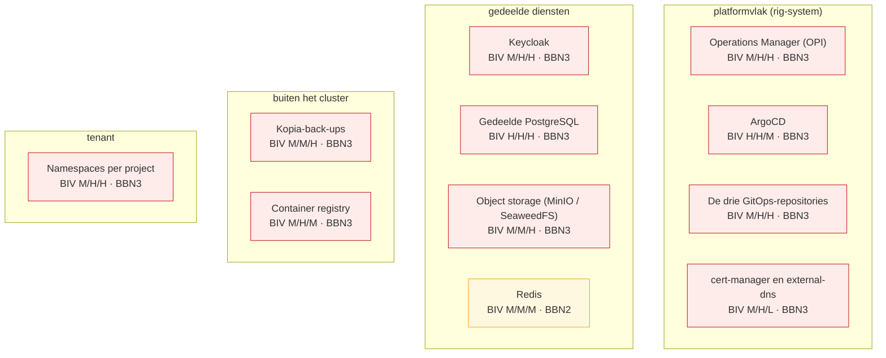

# BIV-overzicht van de ZAD-componenten

Gegenereerd uit [architecture/biv-inventaris.yaml](biv-inventaris.yaml) met `task biv-overzicht`. Bewerk dit bestand niet met de hand: een wijziging hoort in de inventaris, en `tests/test_biv_inventaris.py` meldt het verschil.

Het BBN volgt uit de hoogste BIV-score: L geeft BBN1, M geeft BBN2, H geeft BBN3. Dat BBN bepaalt welke BIO2-maatregelen van toepassing zijn en hoe streng.

## Componenten en trust boundaries

## BIV-score en mitigaties

| Component | Gegevens | Trust boundary | B | I | V | BBN | Mitigatie beschikbaarheid | Mitigatie integriteit | Mitigatie vertrouwelijkheid |
|---|---|---|---|---|---|---|---|---|---|
| Operations Manager (OPI) | Projectbestanden, de AGE-sleutel en API-sleutel per project, Keycloak-beheerwachtwoorden, portaalsessies. | platformvlak (rig-system) | M | H | H | BBN3 | Een upload wordt met een plafond gelezen in plaats van eerst volledig, zodat een grote upload de pod niet OOMKilled maakt. ([bron](../plans/invoer-eerst-schoon-dan-getoetst.md), [toets](../operations-manager/python/tests/test_upload_ceiling.py)) Het aantal verbindingen dat een project op de gedeelde database opent is begrensd, zodat OPI zijn eigen verbindingen houdt. ([bron](../features/postgresql-connection-limits.md), [toets](../operations-manager/python/tests/test_connection_limit.py)) | De namespace van een deployment komt uit de projectnaam en niet uit het projectbestand, dat door de aanvrager te bepalen is. ([bron](../plans/technische-review-bio-en-nora-bevindingen.md), [toets](../operations-manager/python/tests/test_tenant_isolation_namespace.py)) Elke muterende route achter een CSRF-token. ([bron](../features/opi-start-dicht.md), [toets](../operations-manager/python/tests/test_csrf_enforcement.py)) Een gelijktijdige schrijfactie op hetzelfde projectbestand verliest niet stil: de tweede schrijver botst in plaats van de eerste te overschrijven. ([bron](../features/concurrent-write-safety-lost-update.md), [toets](../operations-manager/python/tests/test_external_git_edit_conflict.py)) | Een ontsleuteld geheim kan op geen enkele schrijfweg in git belanden; de guard op het schema weigert de schrijfactie. ([bron](../features/sops-sleutel-roteren.md), [toets](../operations-manager/python/tests/test_plaintext_secret_guard.py)) Projectgeheimen zijn alleen voor admin en owner zichtbaar. ([bron](../features/projectgeheimen-alleen-voor-admin-en-owner.md), [toets](../operations-manager/python/tests/test_projectpagina_geheimen_per_rol.py)) Een portaalsessie heeft een absolute levensduur en uitloggen maakt eerdere sessies ongeldig. ([bron](../features/portaalsessie-levensduur.md), [toets](../operations-manager/python/tests/test_portaalsessie_levensduur.py)) Er is geen vaste of afgeleide standaard voor SECRET_KEY: een opgegeven sleutel die te kort is weigert de start, en zonder opgave komt er een verse random sleutel. ([bron](../features/opi-start-dicht.md), [toets](../operations-manager/python/tests/test_secret_key_failclosed.py)) |
| Keycloak | Identiteiten en sessies van alle portaalgebruikers, een realm met clients en beheeraccount per project. | gedeelde diensten | M | H | H | BBN3 | De realms komen uit blueprints in git, dus een realm is opnieuw op te bouwen zonder handwerk. ([bron](../features/keycloak-yaml-templates.md)) | De koppeling tussen een lokaal account en een externe identiteit staat vast; een tweede account kan hem niet overnemen. ([bron](../features/keycloak-auto-link.md), [toets](../operations-manager/python/tests/test_keycloak_identity_lock.py)) Projectbestand en realm lopen niet stil uiteen: een mislukte lezing van de realm geldt niet als afwezig. ([bron](../plans/keycloak-config-bewerkbaar-zonder-verlies.md), [toets](../operations-manager/python/tests/test_keycloak_drift_guards.py)) | Het realm-beheeraccount staat achter een tweede factor (OTP). ([bron](../features/keycloak-realm-admin-otp.md), [toets](../operations-manager/python/tests/test_keycloak_otp.py)) Uitloggen trekt de sessies in plaats van alleen het koekje te wissen. ([bron](../features/keycloak-always-clear-session-logout.md), [toets](../operations-manager/python/tests/test_sessies_intrekken.py)) |
| Gedeelde PostgreSQL | De databases van alle projecten die geen eigen clusterdatabase kozen. | gedeelde diensten | H | H | H | BBN3 | Een verbindingslimiet per project, zodat een project de verbindingen van de gedeelde server niet voor de andere projecten opmaakt. ([bron](../features/postgresql-connection-limits.md), [toets](../operations-manager/python/tests/test_connection_limit.py)) | Een database is alleen te openen door zijn eigen rollen; PUBLIC CONNECT is ingetrokken. ([bron](../features/database-alleen-eigen-rollen.md), [toets](../operations-manager/python/tests/test_database_publieke_toegang.py)) | Elke verbinding die OPI zelf opzet draagt DATABASE_SSLMODE, want CNPG biedt TLS aan maar dwingt het niet af. ([bron](../features/postgresql-tls.md), [toets](../operations-manager/python/tests/test_database_sslmode.py)) Elk project een eigen database en eigen rollen, geen gedeelde gebruiker. ([bron](../features/postgresql-scope-and-schemas.md), [toets](../operations-manager/python/tests/test_database_publieke_toegang.py)) |
| Object storage (MinIO / SeaweedFS) | Buckets per project, en de bestemming van de back-ups. | gedeelde diensten | M | M | H | BBN3 | Een bucket per project, zodat de quota en de opruiming van het een het ander niet raken. ([bron](../features/backup-system.md)) | De retentie-opruiming werkt binnen de bucket van het project en kiest zijn doel niet zelf. ([bron](../features/backup-retention-sweep.md), [toets](../operations-manager/python/tests/test_backup_retention_sweep.py)) | Een back-up- of restorepod krijgt een S3-account dat alleen bij zijn eigen bucket mag; het beheeraccount van de bestemming blijft bij OPI. ([bron](../features/backup-system.md), [toets](../operations-manager/python/tests/test_backup_bucket_account.py)) |
| Redis | Sessie- en cachegegevens van de projecten die de service binden. | gedeelde diensten | M | M | M | BBN2 | Een eigen Redis per namespace is beschikbaar voor projecten die de gedeelde niet willen delen. ([bron](../features/redis-cloning-consideration.md)) | Een ACL-gebruiker per project, met een sleutelruimte die bij het project hoort. ([bron](../features/redis-acl-persistence.md)) | Een ACL-gebruiker per project, met een eigen wachtwoord uit de projectgeheimen. ([bron](../features/redis-acl-persistence.md)) |
| ArgoCD | De uitrol van elk project, de repository-credentials van de GitOps-repo's en de AppProjects die de grenzen zetten. | platformvlak (rig-system) | H | H | M | BBN3 | Een sync die blijft hangen wordt als zodanig gemeld en blokkeert de volgende niet stil. ([bron](../features/argocd-vastgelopen-verwijdering.md), [toets](../operations-manager/python/tests/test_argocd_stuck_sync.py)) | Het AppProject van een project accepteert alleen de repo's van dat project; het stond op sourceRepos ['*']. ([bron](../features/argocd-appprojects.md), [toets](../operations-manager/python/tests/test_argocd_appproject_sourcerepos.py)) Het default-AppProject staat dicht en het app-of-apps heeft een eigen AppProject met eigen bronnen. ([bron](../features/argocd-appprojects.md), [toets](../operations-manager/python/tests/test_argocd_handwritten_appprojects.py)) | TLS op de ArgoCD-server in plaats van plaintext achter de router. ([bron](../features/argocd-tls.md)) |
| De drie GitOps-repositories | zad-projects (projectdefinities), zad-argo-user-applications (Applications) en zad-deployments (manifests plus SOPS-versleutelde secrets). | platformvlak (rig-system) | M | H | H | BBN3 | De repo's zijn de bron van waarheid en staan in Forgejo op een PVC die meegaat in de clusterback-up. ([bron](../features/backup-system.md)) | OPI ondertekent zijn commits, zodat een commit buiten OPI om herkenbaar is. ([bron](../features/opi-ondertekent-zijn-commits.md), [toets](../operations-manager/python/tests/test_git_signing.py)) Elke commit noemt de gebruiker die de wijziging aanvroeg. ([bron](../features/opi-ondertekent-zijn-commits.md), [toets](../operations-manager/python/tests/test_git_commit_actor_trailer.py)) | De repositories staan prive; Forgejo weigert een lezer zonder sessie. ([bron](../features/forgejo-repositories-prive.md)) Een secret in zad-deployments is SOPS-versleuteld, en de secret-scan in de pijplijn weigert een platte waarde. ([bron](../features/security-scanning-pipeline.md), [toets](../operations-manager/python/tests/test_secret_scan.py)) |
| Kopia-back-ups | Volledige kopieen van de databases, volumes en buckets van elk project. | buiten het cluster | M | M | H | BBN3 | Incrementeel en gededupliceerd, met een retentieschema per project. ([bron](../features/backup-kopia-incremental-deduplication.md), [toets](../operations-manager/python/tests/test_backup_retention_sweep.py)) | Een restore naar een bestemming van buiten is een expliciete opdracht met een eigen verwijzing, niet de standaardweg. ([bron](../features/backup-restore-wizard.md), [toets](../operations-manager/python/tests/test_restore_reference_van_buiten.py)) | De Kopia-repository is versleuteld, en het wachtwoord staat per project in de projectgeheimen. ([bron](../features/backup-system.md), [toets](../operations-manager/python/tests/test_backup_pod_credentials.py)) Een back-uppod draait op de serviceaccount van zijn eigen project. ([bron](../features/backup-system.md), [toets](../operations-manager/python/tests/test_backup_pod_service_account.py)) |
| Container registry | De images van alle projecten, in een gedeelde repository met eigendom in de tag. | buiten het cluster | M | H | M | BBN3 | Een storing op de registry schakelt een deployment niet uit. ([bron](../features/registry-image-ownership.md), [toets](../operations-manager/python/tests/test_registry_outage_no_disable.py)) | Het eigendom van een image zit in de tag en wordt van buitenaf afgedwongen, want een gedeelde repository kent geen geneste scope. ([bron](../features/registry-image-ownership.md), [toets](../operations-manager/python/tests/test_tenant_isolation_registry.py)) | Credentials voor een eigen registry staan AGE-versleuteld in de config van het project. ([bron](../features/registry-image-ownership.md)) |
| cert-manager en external-dns | Certificaten en DNS-records voor elk gepubliceerd adres. | platformvlak (rig-system) | M | H | L | BBN3 | De ACME-uitgifte is een gedeelde bron met een eigen netwerkregel, zodat een project de uitgifte voor de andere niet opmaakt. ([bron](../features/shared-resource-warning-acme-network-policy.md)) | Een adres buiten de eigen zones vraagt een goedkeuring; een niet-goedgekeurd domein komt niet in een ingress. ([bron](../features/domain-restrictions.md), [toets](../operations-manager/python/tests/test_upsert_domain_enforcement.py)) De issuer komt uit het goedgekeurde domein en niet uit het projectbestand, zodat een ingress nooit zonder certificaat blijft. ([bron](../features/external-domains-letsencrypt.md), [toets](../operations-manager/python/tests/test_publish_on_web_issuer.py)) | Een certificaat en een DNS-record zijn publieke gegevens; er is geen vertrouwelijkheidsbelang. ([bron](../features/domain-restrictions.md)) |
| Namespaces per project | De pods, volumes, secrets en serviceaccounts van een project. | tenant | M | H | H | BBN3 | Resourcelimieten per component, met een auto-tuner die binnen het clusterplafond blijft. ([bron](../features/auto-resource-tuning.md)) | Elke weg van projectbestand naar namespace pint de namespace op de projectnaam, dus een opgegeven namespace van een ander project doet niets. ([bron](../plans/technische-review-bio-en-nora-bevindingen.md), [toets](../operations-manager/python/tests/test_tenant_isolation_namespace.py)) Pod Security Standards per namespace, zodat een pod geen privileges kan opeisen. ([bron](../features/pod-security-labels.md), [toets](../operations-manager/python/tests/test_pod_security_labels.py)) | Een NetworkPolicy-baseline per namespace blokkeert verkeer naar de andere tenantnamespaces; de allow-all die er stond deed dat niet. ([bron](../features/restrictive-network-policies.md), [toets](../operations-manager/python/tests/test_tenant_baseline_netpol.py)) De rol in het projectbestand bepaalt wat een lid mag: bewerken en operationele handelingen liggen bij eigen rollenlijsten, en member is een leesrol. ([bron](../features/rollen-voor-operationele-handelingen.md), [toets](../operations-manager/python/tests/test_project_authorization.py)) |

## Doelen van de aanvalsproef

De aanvalsproef leest dezelfde inventaris; deze componenten zijn de doelen: argocd, cert-manager-external-dns, gedeelde-postgresql, gitops-repositories, keycloak, kopia-backups, object-storage, opi, registry, tenant-namespaces.
