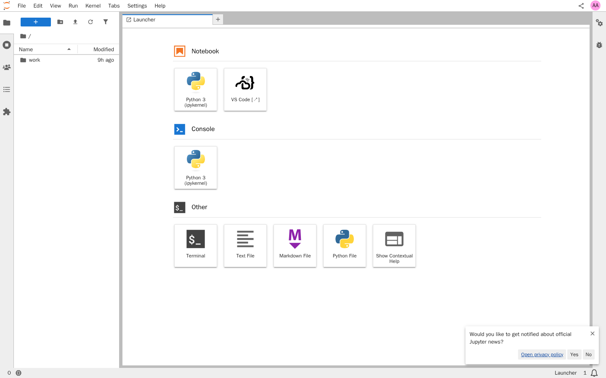
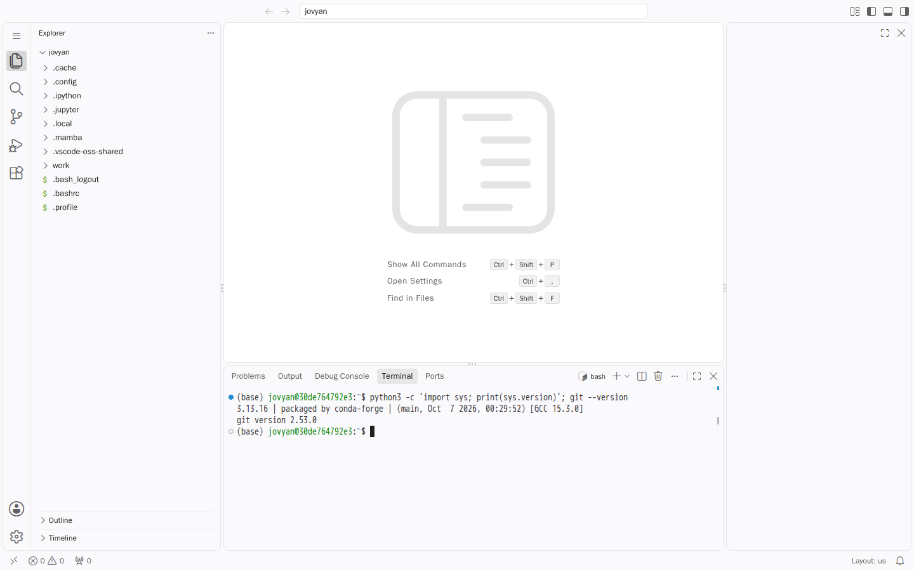

# JupyterHub met KubeSpawner als ZAD-component: verslag

Taak RC-258. Dit verslag groeit per ronde. Rood is hier informatie: een stap die niet lukt
staat erin met de oorzaak, en is geen reden om te stoppen of om eromheen te bouwen.

**Stand: ronde 1, 12 oktober 2026.** Images gebouwd en lokaal getoetst, project aangemaakt
op de sandbox. Taak 4 is half: de Role staat en de rechten zijn afgelezen, maar het
wegnemen van rechten is niet gemeten. Taak 5 tot en met 9 zijn niet gemeten.

## Waartegen gemeten is

| | |
|---|---|
| Cluster | `kind-rig-sandbox`, de gedeelde sandbox op de dev-server |
| OPI | `/version` = `2a4cc405`, branch `een-sync-die-niet-afbreekt-blokkeert-elke-volgende`, build 2026-10-05 |
| Project | `jp-574` (zie "De projectnaam is geen keuze" hieronder) |
| Namespace | `rig-jp-574` |
| Deployment | `productie` |
| ServiceAccount | `jp-574-sa` |
| ClusterIP-Service van de hub | `productie-hub` |
| Podlabel van de tenant-netpol | `deployment: productie` |

De deploymentnaam is `productie` omdat dat de default van de wizard is
(`WIZARD_DEPLOYMENT_NAME_EDITABLE`), en `productie-hub` plus het podlabel volgen daaruit:
`projects/ideas/jupyterhub-poc.yaml` zet die twee in `JUPYTERHUB_POC_HUB_SERVICE` en
`JUPYTERHUB_POC_DEPLOYMENT_LABEL`. Wat wel per aanmaak verschilt is de projectnaam, en
daarmee de namespace en de ServiceAccount: `features/jupyterhub-poc/hub-role.yaml` noemt
de referentienaam en is op de sandbox toegepast met `rig-jp-574` en `jp-574-sa`.

RC-258 wijzigt geen regel OPI, dus er is bewust niet opnieuw uitgerold: de draaiende build
is van een andere PR. Wie deze meting herhaalt, leest `/version` opnieuw voordat hij iets
concludeert.

`sandbox-deploy` kan in een sessie ook niet: het breekt af omdat
`operations-manager/python/.env.sandboxed-local.secrets` ontbreekt. Dat is geen kwijtgeraakt
bestand maar een bewust antwoord: op deze host staat `.sandbox-sso` op `no`, dus SSO Rijk is
bij de setup uitgezet en de OIDC-secrets zijn nooit gezet. Aanzetten is `task
sandbox:configure-sso` door een mens die het productie-clientsecret van de `rig-platform`
realm heeft, en dat hoort niet in een worker-container. Inloggen op het portaal gaat op deze
sandbox dus met het lokale account `admin` / `admin1234` in de realm `operations-manager`.

## Wat het moet aantonen: de stand

| # | Assertie | Stand |
|---|---|---|
| 1 | Login via Keycloak, eigen pod met JupyterLab en VS Code | niet gemeten |
| 2 | Zonder de rol geen toegang; rol kwijt is toegang kwijt | niet gemeten |
| 3 | Twee gebruikers delen een server en bewerken samen | niet gemeten |
| 4 | `git push` naar Forgejo; ongecommit werk overleeft een herstart | niet gemeten |
| 5 | Beide gebruikers lezen dezelfde MinIO-dataset | niet gemeten |
| 6 | Geen SA-token, `kubectl auth can-i create pods` lukt niet | niet gemeten |
| 7 | Geen toegang tot pods van andere projecten | niet gemeten |
| 8 | Culler ruimt op; gebruiker verwijderen haalt pod en PVC weg | niet gemeten |
| 9 | ArgoCD blijft Synced en Healthy, prune laat user-pods staan | niet gemeten |
| 10 | Minimale Role, per regel gemeten | niet gemeten, Role staat als vermoeden klaar |

## Taak 1: hub-image

`images/jupyterhub-hub/`, gebouwd en gedraaid.

- Base `quay.io/jupyterhub/jupyterhub:5.5.2`, **niet** 6.0.1. kubespawner 7.1.0 is van
  16 juli 2026 en JupyterHub 6.0.0 van 1 september 2026, dus de spawner is nooit tegen 6
  getoetst. Dat is de enige reden; 5.5.2 is de laatste van de 5-lijn.
- `configurable-http-proxy` **zit in de base-image** (`/usr/local/bin/configurable-http-proxy`),
  dus de hub draait de proxy als subproces in dezelfde pod. Dat was de open vraag in het plan.
- Base-image draait als root; de image zet `USER 1001` zodat hij op het ZAD-podprofiel past.
- Python is een venv op `/srv/venv`, dus `pip install` werkt zonder `--break-system-packages`
  ondanks de `EXTERNALLY-MANAGED`-markering op de systeem-Python.

Gemeten in de gebouwde image:

```
$ docker run --rm --entrypoint sh jupyterhub-poc-hub:rc258 -c 'id -u; jupyterhub --version; ...'
1001
5.5.2
kubespawner 7.1.0
oauthenticator 17.4.0
idle-culler ok
```

En een echte start met de env die het project levert: de hub leest de config zonder een
enkele niet-herkende traitlet, zet de rollen `user` en `idle-culler` in de database, start
`configurable-http-proxy` op `:8000`, luistert met de hub-API op `0.0.0.0:8081` en meldt
`Private Hub API connect url http://<service>:8081`. De idle-culler start en loopt daarna
stuk op DNS, want `<service>` bestaat lokaal niet; dat is het verwachte verschil met het
cluster.

## Taak 2: user-image

`images/jupyterhub-user/`, gebouwd en in een browser bekeken.

**Bevinding, gerepareerd: `jupyter-vscode-proxy` 0.7 declareert geen dependencies.** De
schets in `features/online-ontwikkelomgeving-trainees.md` installeert alleen
`jupyter-vscode-proxy`, en dan is er geen `jupyter-server-proxy` en dus geen serverextensie
die `/vscode` bedient. Gemeten: `jupyter server extension list` kende `jupyter_server_proxy`
niet, en de tegel bleef weg. Met `jupyter-server-proxy==4.6.0` erbij staat er
`jupyter_server_proxy 4.6.0 OK` en `@jupyterhub/jupyter-server-proxy v4.6.0 enabled OK`.

**Bevinding, gerepareerd: code-server 4.141 bundelt zelf een Copilot-chatpaneel.** Zonder
dat er een extensie geinstalleerd is, staat er een "Build with Agent"-paneel in de editor en
een `.copilot`-map in de home. In `product.json` staat `defaultChatAgent =
GitHub.copilot` en `builtInExtensionsEnabledWithAutoUpdates = ['GitHub.copilot-chat']`. Dat
is precies de Big Tech-afhankelijkheid die wens 7 in
`features/online-ontwikkelomgeving-trainees.md` uitsluit. `chat.disableAIFeatures` staat nu
in de image; het paneel is weg.

**Bevinding, gerepareerd: elke terminal vroeg eerst om vertrouwen.** VS Code opent de eigen
home in Restricted Mode en vraagt bij de eerste terminal "Do you trust the authors of the
files in this folder?". De isolatiegrens is de pod en niet dat dialoogvenster, dus
`security.workspace.trust.enabled` staat uit.

Gemeten in de image: `git version 2.53.0` (zat al in de base), `code-server 4.141.0 with
Code 1.141.0`, Python 3.13.16, en de extensies `ms-python.python@2026.4.0` en
`detachhead.basedpyright@1.40.2` van Open VSX.





## Taak 3: het projectbestand

### De projectnaam is geen keuze

`projects/ideas/jupyterhub-poc.yaml` is een **referentiebestand**: het beschrijft de stand
die het project moet hebben, en is niet iets dat je als bestand kunt uitrollen. ZAD leidt de
technische naam af van de weergavenaam en plakt er een willekeurig achtervoegsel aan
(`CreateProjectRequest`: "The technical name is not an input"). "JupyterHub POC" werd dus
`jp-574`, en de namespace `rig-jp-574`. Alles wat van de projectnaam afhangt verschilt
daarmee per aanmaak: de namespace in `features/jupyterhub-poc/hub-role.yaml`, de naam van de
ServiceAccount (`jp-574-sa`) en de image-adressen in de registry.

Wat NIET van de projectnaam afhangt, en dus wel vastligt: de ClusterIP-Service van het
component is `<deployment>-<component>` (`generate_unique_name`), en het podlabel waar de
tenant-netpol op selecteert is de deploymentnaam.

### Hoe het is aangemaakt

Via de wizard, met het lokale admin-account. De API-weg kan niet: `POST /api/v2/projects`
vraagt een BearerToken en de draaiende OPI heeft geen `API_TOKEN` in zijn omgeving, dus die
valt terug op een per-proces willekeurige waarde. Alles NA het aanmaken gaat wel via de API,
met de projectsleutel.

### Twee dingen die in de wizard opvielen

1. **De snelstart "Toegangsbeperking" laat het verplichte veld Template leeg.** Het vinkje
   zet de rolbeperking aan, maar de stap kan daarna niet verder: "Dit veld is verplicht" bij
   Keycloak template. Dat raakt ook `tests/e2e/helpers/lifecycle.py`, waar
   `_fill_service_config_step` nog zegt "leave the template at its default (sso-support)" en
   dus op deze build op de keycloak-stap blijft hangen. Niet gerepareerd: het valt buiten
   RC-258 en de draaiende build is van een andere PR. Opgeschreven zodat het niet verloren
   gaat.
2. **De eerste keuze in de templatelijst is `sso-only`.** Voor deze POC moet het
   `sso-support` zijn, anders kan de realm geen lokale accounts hebben en zijn de drie
   testgebruikers niet aan te maken. Op de sandbox staat SSO Rijk uit, dus `sso-only` zou de
   hele inlogmeting onmogelijk maken.

### Wat er nu staat

Project `jp-574`, deployment `productie`, component `hub`, in `rig-jp-574`. Diensten:
`publish-on-web`, `keycloak`, `persistent-storage` (mount `data` op `/data`, 100Mi) en
`minio-storage`. Via de API bijgesteld: template naar `sso-support`, realm-rol
`jupyterhub-user` als poort, inbound-poorten naar `[8000, 8081]`, en de
`JUPYTERHUB_POC_*`-variabelen.

Afgelezen op het cluster, zodat `projects/ideas/jupyterhub-poc.yaml` dezelfde waarden
noemt als wat er draait:

```
$ kubectl -n rig-jp-574 get svc
productie-hub   ClusterIP   10.96.29.86   8000/TCP,8081/TCP

$ kubectl -n rig-jp-574 get secret productie-hub-user -o jsonpath=...
JUPYTERHUB_POC_HUB_SERVICE=productie-hub
JUPYTERHUB_POC_DEPLOYMENT_LABEL=productie
```

De hub-API komt dus als tweede poort op dezelfde ClusterIP-Service te staan, waarmee
`hub_connect_url` bereikbaar is. De acht `OBJECT_STORE_*`-namen die de config doorgeeft aan
de user-pods staan alle acht in het dienstsecret `productie-minio` en komen via `envFrom`
op de container, `OBJECT_STORE_URL` en `OBJECT_STORE_ENDPOINT_URL` inbegrepen: die twee zijn
geen `VariableDefinition` maar worden door `MinIOSecret._get_additional_keys()` berekend.

Het referentiebestand noemde in de eerste gang nog `lab-hub` en `lab`, de naam die bij een
andere deployment hoort. Op het cluster stond het goed, want dat is met de hand gezet, maar
wie het bestand zou volgen krijgt een `hub_connect_url` naar een Service die niet bestaat en
user-pods zonder netpol. De twee toetsen die deze twee variabelen pinnen zien dat niet, want
ze lezen de deploymentnaam uit datzelfde bestand; er staat nu een derde toets naast die de
naam tegen de default van de wizard legt.

### Wat er mis ging op de sandbox, en waarom

**De user-image van 2,7 GB komt niet door de push-API.** De hub-image (536 MB) wel: HTTP 200
in een paar minuten. De user-image is 2,72 GB (base `minimal-notebook` 1,67 GB plus 965 MB
voor code-server) en die kwam er twee keer niet door:

- Poging 1: nginx bufferde 2,8 GB naar een tijdelijk bestand, de upstream deed er 214 s
  over, en de verbinding brak. nginx logde `499` (client sloot de verbinding), curl zag 502.
  Het is geen bodylimiet: de ingress van OPI heeft `proxy-body-size: "0"` en
  `proxy-read-timeout: 600`. De OPI-pod herstartte niet, dus een OOM op zijn geheugenlimiet
  van 1 GiB is het ook niet.
- Poging 2 is afgebroken, niet omdat hij faalde maar omdat hij de gedeelde machine
  leegtrok: `docker save` van 2,7 GB duurde meer dan twaalf minuten en de load van de host
  stond boven de 30 (er draaien meer sessies). Daarbij viel de API-server van het
  kind-cluster herhaaldelijk om (`couldn't get current server API group list: EOF`), en
  twee OPI-taken faalden daardoor met `kubectl connection is not available`. Na het
  afbreken zakte de load naar 12 en kwam de API-server terug.

Dit hoort in de volgende ronde opgelost te worden en niet omzeild: een image van 2,7 GB
moet ook door de kubelet gepulld worden bij elke spawn, dus klein maken is sowieso winst.

**De control plane van de sandbox crasht onder die belasting.** Gemeten om 13:25 UTC:

```
kube-apiserver-rig-sandbox-control-plane            Running             54 restarts, laatste 13:25:29Z
kube-controller-manager-rig-sandbox-control-plane   CrashLoopBackOff   364 restarts, laatste 13:23:53Z
kube-scheduler-rig-sandbox-control-plane            CrashLoopBackOff   370 restarts, laatste 13:24:46Z
```

De controller-manager verliest zijn leader-election lease omdat de API-server niet binnen
5 s antwoordt (`context deadline exceeded` op de lease-PUT), waarna `leaderelection lost`
en exit 1. Dat verklaart alles eromheen: `kubectl connection is not available` in OPI, en
een Deployment waarvan het image wijzigt die wel `Progressing=True, ReplicaSetUpdated`
meldt maar geen nieuwe ReplicaSet en dus geen pod krijgt.

De host heeft 15,5 GiB. Het aandeel van deze taak was de 2,7 GB `docker save`; na afbreken
zakte de load van 30+ naar 2 en kwam de API-server terug. Maar 364 restarts is niet van
deze middag, en tijdens de piek stond een zustersessie op 336% CPU. De vraag of een sessie
die een groot image moet uitrollen dat anders hoort te doen, staat bij DistributedClaude.

**De drie API-aanroepen tegelijk versturen is te veel voor deze sandbox.** De eerste gang
stuurde keycloak-config, de poortwijziging en de env-vars vlak na elkaar; alle drie faalden
op `kubectl connection is not available`, waarna de verbinding zichzelf herstelde
(`Kubectl connection restored`). Een voor een, op een rustige machine, slagen ze wel. Let
op: de SCHRIJFKANT van zo'n taak lukt ook als het verwerken faalt. Het projectbestand had de
nieuwe poorten en de keycloak-config al; alleen het uitrollen was niet gebeurd.

**`POST .../user-env-vars/values/...` is niet idempotent.** Een herhaling van dezelfde POST
geeft `Bestaat al: ...  Gebruik PATCH om een bestaande waarde te wijzigen.` Dat is een nette
melding, maar het betekent dat een script dat opnieuw moet draaien PATCH hoort te gebruiken.

**Een image uit de push-API van ZAD is niet pullbaar door de pods van hetzelfde project.**
De hub-image staat in de registry (`registry.sandbox.rijksapp.dev/rig:jp-574_hub-rc258`,
HTTP 200 op de push), maar de pod komt niet verder dan:

```
Failed to pull image "registry.sandbox.rijksapp.dev/rig:jp-574_hub-rc258":
  pull access denied, repository does not exist or may require authorization:
  authorization failed: no basic auth credentials
```

Er is geen pull-secret: niet in de namespace (`kubectl get secrets` toont alleen de vier
dienst-secrets en `sops-age-key`), niet op de ServiceAccount, en niet in de podspec. De
push-API zet het image dus wel in de registry van het platform, maar regelt niet dat het
project het eruit mag halen. Dat loopt via de dienst `image-registries`
(`features/image-registries.md`), die de POC nog niet aan heeft staan. Dit is de volgende
stap voor taak 3, en het is een inrichtingsvraag voor ZAD, niet iets dat je met de hand
oplost.

**Het image van het COMPONENT is niet het image dat draait.** `PATCH .../components/hub` met
`image` zet `components[].image` in het projectbestand; het manifest leest
`deployments[].components[].image`. Daarvoor is
`PUT .../deployments/{deployment}/image` met `componentName` nodig.

## Taak 4: de rechten

De Role en RoleBinding uit `features/jupyterhub-poc/hub-role.yaml` zijn met de hand
toegepast, met de namespace en de ServiceAccount van het echte project
(`rig-jp-574`, `jp-574-sa`).

Gemeten met `kubectl auth can-i --list --as=system:serviceaccount:rig-jp-574:jp-574-sa`:

```
persistentvolumeclaims   [get list watch create delete]
pods                     [get list watch create delete]
events                   [get list watch]
```

Verder niets in de namespace: `deployments` en `secrets` geven `no`. Voor het toepassen had
de ServiceAccount geen enkele RoleBinding in de namespace (alleen de twee van ArgoCD staan
er, en die wijzen naar hun eigen accounts), dus deze rechten komen volledig van dit bestand.

**Bevinding, gerepareerd: elke rollout van het hubcomponent haalde de user-pods weg.**
`c.JupyterHub.cleanup_servers` stond niet in de config en de standaard is `True`
(jupyterhub 5.5.2, `app.py:1540`; `app.py:3497` stopt bij het afsluiten elke actieve
spawner). De hub stopt bij een rollout dus eerst elke draaiende server, en dat is precies
wat assertie 9 en taak 8 moeten uitsluiten. Hij staat nu op `False`; `cleanup_proxy` blijft
aan, want de proxy is een subproces van de hubpod. Niet op het cluster nagemeten: dat
vraagt een spawn die slaagt, en daarvoor moet de user-image pullbaar zijn.

**Nog niet gemeten:** of elk van deze rechten ook nodig is. Dat vraagt een spawn die slaagt,
en daarvoor moet de user-image in de registry staan. De rechtvaardiging per regel in
`hub-role.yaml` staat daarom nog als **vermoeden** gemarkeerd.

Een meetvraag die hierbij open bleef: `kubectl auth can-i get pods/exec --as=...` antwoordt
`yes` terwijl de Role alleen `pods` noemt en `can-i --list` geen subresources toont. Of dat
een eigenaardigheid van `can-i` is of echte toegang, is nog niet uitgezocht; een
`SubjectAccessReview` met een expliciete `subresource` is de meting, en die liep stuk op de
API-server die toen net omviel. Dit is belangrijk voor assertie 6 en 7 en mag niet blijven
staan als vermoeden.

## Taak 5 tot en met 9

Nog niet gemeten.

## Opruimen

```bash
# Het project, inclusief namespace, realm, bucket en ArgoCD-applicaties.
curl -sk -X DELETE "https://zad.sandbox.rijksapp.dev/api/projects/<naam>" -H "X-API-Key: <sleutel>"

# De Role en RoleBinding staan buiten GitOps en gaan met de namespace mee; staat de
# namespace er nog, dan met de hand:
kubectl -n rig-<naam> delete role,rolebinding jupyterhub-spawner
```

## Volgende stap

1. **De dienst `image-registries` op het project**, zodat de pods het image mogen pullen
   dat de push-API er neerzette. Zonder dat komt de hub niet verder dan ImagePullBackOff.
2. **De user-image kleiner maken, en niet als tarball uitrollen.** De bedoelde weg is
   bouwen en pushen naar de registry; `docker save` van 2,7 GB is precies wat uit
   `sandbox-deploy` is gehaald, en op deze host legt het de control plane om.
3. **Taak 4 afmaken**: rechten wegnemen en kijken wat er stukgaat, zodra een spawn kan
   slagen. Plus de open meetvraag over `pods/exec`.
4. Taak 5 tot en met 9.
