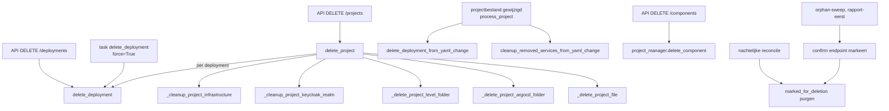

# De verwijderpaden van OPI in kaart

Status: **onderzoek, niets gerepareerd.** Dit document beschrijft hoe het verwijderen vandaag
werkt, waar het misgaat, en wat het plan daarna moet halen. De reproducties staan als
`xfail(strict=True)` in `operations-manager/python/tests/test_verwijderpaden_reproducties.py`:
ze worden rood zodra een reparatie landt, en dat is de bedoeling.

Gemeten op 23 oktober 2026, op `forgejo/main` en op het sandboxcluster
(`kind-rig-sandbox`, cluster `sandboxed-local`).

## Waarom deze kaart er is

Het verwijderen is meerdere keren gerepareerd (RC-226, RC-254, RC-265, RC-345) en houdt
randgevallen. De reden blijkt uit de kaart hieronder: er zijn zes ingangen die elk hun eigen
subset van negen lagen opruimen, in een eigen volgorde, met een eigen antwoord op "wat als
deze stap faalt". Niemand bezit het geheel, en er is geen enkele plek die na een verwijdering
toetst of het klaar is.

**De observatie van de opdrachtgever.** Een verwijdering lukt tot nu toe uiteindelijk wel. Maar het gaat niet lekker, op drie manieren:

| Symptoom | Wat de gebruiker ziet | Gemeten in |
|---|---|---|
| **traag** | een deployment verwijderen duurt zeven minuten, en bij drie deployments gebeurt dat drie keer achter elkaar | geval 4: 430s per deployment, waarvan 380s wachten op twee klokken |
| **valse uitkomst** | "not fully deleted" terwijl alles weg is | geval 4 |
| **achtergebleven rest** | niets meldt het, en het projectbestand dat het nog zou kunnen melden is zelf weg | geval 1, 2 en 5 |

Wat het plan daarna als eerste moet oplossen is daarmee niet een herbouw: het is dat de
**uitkomst klopt** en **snel zichtbaar** is. Geen "mislukt" op een verwijdering die lukte, geen
stille rest. Sectie 6 zegt per voorstel welk van deze drie symptomen het wegneemt, en 6.1 staat
vooraan omdat die drie voorstellen alle drie de symptomen raken zonder iets structureel te
veranderen.

De vijf storingen in sectie 4 komen uit hetzelfde gat. **Geval 1 veroorzaakte geval 2.** Geval 2 en 4 zijn dezelfde meetfout: `Forbidden` maakt de inventaris onvolledig, en onvolledig leest als "niet klaar". **Geval 5 is geval 2 nog een keer**, maar dan drie van de vijf keer in één gewone teardown: daar is het geen incident meer maar de normale uitkomst van een project met twee deployments waarvan er een nooit gezond werd.

## 1. De lagen

Een project leeft in negen lagen. Een verwijdering is pas klaar als elke laag leeg is.

| # | Laag | Bron van waarheid | Wie schrijft |
|---|---|---|---|
| 1 | `zad-projects/projects/<project>.yaml` | git | OPI en de gebruiker |
| 2 | `zad-argo-user-applications/<cluster>/<project>/` | git | alleen OPI |
| 3 | `zad-deployments/<cluster>/<project>/<deployment>/` en `/_project` | git | alleen OPI |
| 4 | ArgoCD: `Application`, `AppProject`, repository-secret | de Kubernetes-API, niet de ArgoCD-API | de root-application `user-applications` |
| 5 | De namespace `rig-<project>` en alles erin | de Kubernetes-API | ArgoCD, via de finalizer |
| 6 | PostgreSQL: database, gebruiker | de PostgreSQL-server | OPI direct |
| 7 | MinIO: bucket, gebruiker, policy | de MinIO-server | OPI direct |
| 8 | Keycloak: realm, clients, master-admin | de Keycloak-server | OPI direct |
| 9 | Eigen tabellen: `subdomains`, `marked_for_deletion`, `async_tasks` | de OPI-database | OPI direct |

Twee eigenschappen van laag 4 bepalen alles wat hierna komt.

**`user-applications` is één Application voor het hele cluster.** Eén kustomize-render over
alle projectmappen, met `prune: true`, `selfHeal: true` en `retry.limit: -1`
(`bootstrap/rig-system/kustomize/overlays/*/argocd-application-user-applications.yaml`). Eén
projectmap die de render breekt, of één resource waarvan de verwijdering blijft hangen, zet de
sync stil voor **elk** project op dat cluster.

**OPI vraagt alleen een refresh, nooit een sync.** Elk verwijderpad haalt een bestand uit laag
2 en roept dan `refresh_application("user-applications")`. Dat hertoetst alleen de gewenste
staat (`?refresh=normal`, `opi/connectors/argo.py:567`); het *toepassen* laat het aan ArgoCD.
Daarna wacht het pad tot de `Application` verdwenen is. Komt de sync er niet aan toe, dan meet
die wacht niets: de Application is dan nooit gevraagd om te gaan. Een mislukte refresh is
expliciet niet-fataal ("continuing anyway", `delete_project_manager.py:1580`).

## 2. De paden



### Pad 1: `delete_project` (regel 1038)

De enige ingang die alle negen lagen aanraakt. Volgorde:

| Stap | Wat | Bij een fout |
|---|---|---|
| 1-3 | Projectbestand lezen, deployments per cluster splitsen | deployments op een ander cluster: **stopt**, niets gewijzigd |
| 4 | Per deployment `delete_deployment` | zonder `force`: `success=False` en de rest wordt overgeslagen; **met `force`: loopt door** |
| 4.5 | Infrastructuurnamespace (eigen PostgreSQL/Redis) | fout in `errors`, loopt door |
| 4.6 | Keycloak-realm, master-admin, platform-client, configblok | fout per substap in `errors`, loopt door |
| 4.65 | `_project` uit de deployments-repo (laag 3) | fout in `errors`, loopt door. De uitkomst van `commit_and_push_changes` wordt **niet gelezen** |
| 4.7 | De hele projectmap uit de argo-repo (laag 2) | ontbrekende map met deployments: `success=False`, **stopt** (RC-265) |
| 5 | Het projectbestand (laag 1) | alleen als `success` **of** `force` |
| 6 | `subdomains`, cachecontrole | fout in `errors`, nooit blokkerend |

Stap 4.7 heeft al een grendel die weigert als de map ontbreekt terwijl er deployments waren.
Stap 5 heeft die grendel niet voor de andere lagen: `force` haalt het projectbestand weg ook
als stap 4 de namespace heeft laten staan. Dat is geval 2, en bij een project met twee
deployments in dezelfde namespace is het de normale uitkomst (geval 5).

**Dekking vandaag.** `test_delete_project_manager.py` dekt de orkestratie en drie van de
substappen: `TestCleanupProjectInfrastructure` (acht toetsen, waaronder een mislukte
namespace-delete die zichtbaar moet blijven) stap 4.5, `TestDeleteProjectArgocdFolder` (vijf
toetsen, inclusief de RC-265-grendel en de beslissing binnen de gelockte mutatie) stap 4.7, en
`TestDeleteProjectOrchestration` de volgorde plus de overslag zonder `force` tegenover het
doorlopen met `force`. Stap 4.6 heeft daarnaast `test_delete_keycloak_cleanup.py` (negen
toetsen, per substap). Stap 4.65 heeft één toets, het geslaagde geval, in
`test_project_manifest_emitter.py`. Dat deployments op een ander cluster het pad stoppen, wordt
een laag hoger gemeten, in `test_delete_task_handlers.py`, en de API-grendel ervoor in
`test_api_delete_project_step_up.py` (zes toetsen).

**Wat geen enkele toets raakt.**

- **De grendel van stap 5 zelf.** De vijf orkestratietoetsen die stap 5 bereiken mocken
  `_delete_project_file` weg en geen enkele kijkt daarna of hij werd aangeroepen; `success or
  force` is dus niet gemeten. `test_een_achtergebleven_namespace_houdt_het_projectbestand` is de
  eerste, en `test_een_projectbrede_verwijdering_ruimt_de_namespace_op` meet wat er dan achter
  blijft.
- **De foutkant van stap 4.65.** Dat de uitkomst van `commit_and_push_changes` niet gelezen
  wordt, kan geen toets zien: de enige toets op die stap is het geslaagde geval.
- **Stap 6.** `delete_by_project` wordt in elke toets weggemockt en in geen enkele nagelopen.
  De connector zelf is wel gedekt (`test_subdomain_connector.py`), de aanroep uit dit pad niet.

### Pad 2: `delete_deployment` (regel 1388)

| Stap | Wat | Bij een fout |
|---|---|---|
| 1 | Projectbestand en deployment lezen | 404 (met `force`: `already_absent=True`, succes) |
| 2 | Uit laag 2: de Application van deze deployment, het AppProject als geen andere deployment deze namespace gebruikt, de repository-secrets als geen andere deployment deze repo gebruikt, dan de kustomization herbouwen, alles in één mutatie en commit | **gooit door** (RC-265), zodat de worker het opnieuw doet |
| 3 | `refresh_application("user-applications")` | gelogd, loopt door |
| 4 | Wachten tot de `Application` weg is: 40 pogingen van 5s, uitgebreid zolang de namespace meetbaar leegloopt tot het budget van 600s per taak | timeout: zonder `force` alleen gemeld; met `force` de veegactie plus finalizer |
| 5 | De namespace, alleen als stap 4 BEVESTIGD was en geen andere deployment hem gebruikt | onbevestigd zonder `force`: namespace blijft, `success=False`. Mislukte `delete`: `success=False` |
| 6 | Keycloak (altijd direct), database en MinIO (direct, of gemarkeerd bij een `data-retention-period`) | fout in `errors`; database-fout met `force`: overgeslagen |
| 7 | De manifestmap uit laag 3, alleen als stap 4 bevestigd was | onbevestigd: gemarkeerd als `deployment_manifests` voor de nachtelijke purge |
| 8 | De deployment uit het projectbestand, alleen als 4 en 7 beide klaar zijn | blijft staan zodat een retry het kan afmaken |

Stap 8 is bewust conservatief, en dat is goed: zolang de resources staan blijft de delete
herhaalbaar. Maar de entry die blijft staan is voor de **volgende** verwijdering een gewone,
levende deployment. Daarmee leest de toets in stap 2 en stap 5 ("gebruikt een andere deployment
deze namespace?") een deployment die niet meer bestaat, en slaat de verwijdering van het
AppProject en de namespace over. Zo ontstond `rig-rl437-56m`, en zo hielden drie van de vijf
projecten in de reallife-teardown hun namespace (geval 5). Bij een projectbrede verwijdering komt
daar nog bij dat die toets een zuster die in DEZELFDE ronde wordt verwijderd niet kan
onderscheiden van een zuster die blijft: bij de eerste beurt staat de entry van de tweede er per
definitie nog.

**Dekking vandaag.** Dit is het best gedekte pad. Stap 1 heeft
`test_delete_deployment_already_absent.py` (vier toetsen: de echte delete, de 404 met `force`,
de markering `already_absent`, en een niet-404 die een fout blijft). Stap 2 heeft
`test_zombie_deployment.py` plus `TestDeleteDeploymentSeparation`: een mislukte push en een
mislukte commit laten de deployment staan en wachten niet op ArgoCD, en de AppProject- en
repository-bestanden zijn weg voordat de kustomization herbouwd wordt. Stap 3 en 4 hebben
`test_argocd_stuck_delete.py` (2067 regels: de inventaris, welk type `kubectl` weigerde, de
patch op `/operation`, de veegactie, het voortgangsvenster en het budget per taak) en
`test_verdwenen_applicatie_tijdens_wacht.py`. Stap 6 heeft
`test_delete_project_manager.py::test_deployment_resources_are_cleaned` en
`test_delete_deployment_ruimt_oom_staat_op.py`. Stap 7 en 8 hebben drie toetsen in
`test_zombie_deployment.py`: een mislukte commit en een mislukte verwijdering van de manifestmap
laten de deployment in het bestand staan, een geslaagde delete haalt hem weg. Hoe de uitkomst
de taak rood maakt, meten `test_delete_deployment_honest_failure.py` en
`test_task_handlers_progress.py`.

**Wat geen enkele toets raakt.**

- **De grendel "gebruikt een andere deployment deze namespace?" in stap 2 en 5.** Geen toets
  varieert de deployments in het projectbestand om die beslissing te meten; het AppProject komt
  alleen voor in de ORDENINGS-toets hierboven. `test_de_projectapplicatie_houdt_het_appproject_in_de_map`
  is de eerste die de grendel van stap 2 zelf bevraagt, en daarmee de oorzaak van geval 1 en van
  `rig-rl437-56m`. Voor de grendel van stap 5 doet
  `test_een_projectbrede_verwijdering_ruimt_de_namespace_op` dat, door het projectbestand te
  laten meebewegen met stap 8 (geval 5).
- **De tak `retention_hours > 0` in stap 6** (regel 1816): markeren in plaats van verwijderen.
  De parser is gedekt (`TestParseRetentionPeriodHours`, negentien waarden), de tak die hem
  gebruikt niet.

### Pad 3: `delete_deployment_from_yaml_change` (regel 2191)

Dezelfde stappen als pad 2, met vier verschillen:

- Geen stap 8: de gebruiker heeft de entry zelf weggehaald, dus het bestand is de **invoer**.
- Persistente resources gaan naar `marked_for_deletion` in plaats van direct weg.
- Het backup-prefix en de namespace worden gemarkeerd, met het Kopia-wachtwoord in de metadata,
  zolang de namespace nog bestaat.
- De namespace wordt alleen verwijderd als er geen gemarkeerde resources zijn.

Hier zit een stille fout: `project_manager.py:3343` doet `await ...delete_deployment_from_yaml_change(...)`
**zonder de uitkomst te lezen**. Alleen een opgegooide exceptie wordt een `critical_failure`.
Een verwijdering die `success=False` met errors teruggeeft, wordt genegeerd en de ronde meldt
succes. Vergelijk stap 1.7 twintig regels lager, die zijn resultaat wel leest.

**Dekking vandaag.** Vijf toetsen, verdeeld over twee bestanden:
`test_delete_project_manager.py` meet dat een 403 op de voorcontrole geen mislukte verwijdering
is en dat de AppProject-bestanden voor de herbouw weg zijn, `test_argocd_stuck_delete.py` dat
dit pad de `/operation` leegmaakt voor het wachten, dat het voortgangsvenster meegaat, en dat
het het projectbestand nooit terugschrijft.

**Wat geen enkele toets raakt.**

- **De markeringen die dit pad van pad 2 onderscheiden** (regel 2493 tot 2605: het
  backup-prefix, de namespace met het Kopia-wachtwoord in de metadata, de uitgestelde
  services). Alle vijf de toetsen roepen het pad aan ZONDER `marked_for_deletion_service`, dus
  die hele tak draait in geen enkele toets. De markeerservice zelf is wel gedekt
  (`test_marked_for_deletion.py`), de aanroep uit dit pad niet.
- **De aanroeper die de uitkomst weggooit** (`project_manager.py:3343`). De twee toetsen die
  `process_project` hierlangs voeren (`test_refresh_without_deployments.py`,
  `test_gereserveerde_projectnamen.py`) zetten `_analyze_deployment_changes` op een lege dict,
  dus de tak met verwijderde deployments wordt door geen enkele toets uitgevoerd. Dat is ook de
  reden dat deze fout zo lang kon blijven staan.

### Pad 4: `cleanup_removed_services_from_yaml_change` (regel 2730)

Alleen de deployments die in beide versies bestaan, alleen de services die eruit gingen, via de
`handle_service_removal` van elke provider. Raakt laag 6, 7, 8 en 9, nooit 1 tot 5. Een fout per
service komt in `errors` en die uitkomst wordt wel gelezen.

**Dekking vandaag.** Ruim: `test_service_change_detection.py` (21 toetsen) meet per provider of
een verwijderde service direct weg gaat of gemarkeerd wordt, meerdere services tegelijk, een
TOEGEVOEGDE service die geen verwijdering is, dat een verwijderde deployment niet nog eens langs
dit pad komt, en dat een fout van een provider wordt opgevangen in plaats van opgegooid.

**Wat geen enkele toets raakt.** Dat stap 1.7 van `process_project` de uitkomst wel leest, is om
dezelfde reden als bij pad 3 door geen toets gemeten: geen toets voert `process_project` met een
echte servicewijziging uit. Hier is dat geen bug, alleen ongedekt gedrag.

### Pad 5: `project_manager.delete_component` (regel 8360)

Raakt **alleen laag 1**. Het weigert een component die nog in gebruik is (tenzij
`confirm_in_use`), haalt de definitie en alle verwijzingen uit het projectbestand, en commit.
Verder niets: geen manifest, geen Keycloak-client, geen ingress. Het opruimen van de
gegenereerde bestanden hangt aan de volgende verwerking, en dat is volgens
`features/manifest-inventory-cleanup.md` nog niet volledig gebouwd. Wat blijft staan, labelt
`features/orphan-component-error-labeling.md` op de projectpagina.

**Dekking vandaag.** `test_component_delete_manager.py` (zestien toetsen) meet elke weigering
(in gebruik door een deployment, door een ander component, het domeincomponent), dat er niets
geschreven wordt voor een weigering, dat het één save is die niets naar het component laat
wijzen, en wat het commitbericht zegt. `test_component_delete_api.py` dekt het endpoint en
`test_delete_task_handlers.py` (zes toetsen) dat de bevestiging naar de schrijflaag reist en dat
een mislukte herverwerking erna zichtbaar blijft.

**Wat geen enkele toets raakt.** Wat er met de gegenereerde bestanden in laag 2 en 3 gebeurt na
een componentverwijdering. Dat hangt aan de volgende verwerking en daar is geen toets op; de
labeling van wat blijft staan is de enige zichtbaarheid.

### Pad 6: de orphan-sweep en de nachtelijke purge

`opi/jobs/service_orphan_sweep.py` inventariseert en **muteert nooit**: databases, Keycloak-realms
en -clients, MinIO-buckets, de projectmappen in de argo-repo, en verdwaalde markeringen. Een
bevestiging via het endpoint markeert ze voor `opi/jobs/reconciliation.py`, dat 's nachts de
verlopen markeringen opruimt (`RECONCILIATION_DRY_RUN`, in productie nog een dry-run, #205).

Drie dingen vallen buiten de sweep, en daar liggen de gevallen 1 tot 3:

- **ArgoCD-Applications, AppProjects en namespaces.** Niet geïnventariseerd. Een Application die
  naar een verdwenen AppProject wijst ziet niemand.
- **De INHOUD van een projectmap in de argo-repo.** De sweep vraagt alleen of er nog een project
  met die naam bestaat (regel 302-342). Bestaat het, dan heet de map `expected`, hoe half ook.
- **De deployments-repo.** Helemaal niet geïnventariseerd. Vandaag staan er vier weesmappen in
  `zad-deployments/sandboxed-local/`: `rl437-56m`, `alls5-5ke`, `enval-pwv`, `rl069-9mb`, en van
  geen van die vier bestaat het project nog.

**Dekking vandaag.** `test_service_orphan_sweep.py` meet de classificatie van databases en
Keycloak-clients (system, expected, orphan-candidate, unknown), het clusterfilter, dat alleen een
actuele kandidaat via het endpoint bevestigd kan worden, dat de dry-run Keycloak niet aanraakt,
dat een map zonder project een kandidaat is, en dat de werkboom eerst ververst wordt.
`test_marked_for_deletion.py` dekt het markeren en de nachtelijke purge, inclusief de weigering
bij actieve databaseverbindingen, de grace-periode en het terugdraaien van een markering als de
resource weer in het projectbestand staat. `test_reconciliation_scheduler.py` dekt het uur en de
dry-run als standaard, `test_admin_projects_reconcile.py` het endpoint.

**Wat geen enkele toets raakt.** De drie gaten hierboven, en dat is geen toeval: de code is er
niet, dus er is ook niets om te toetsen. `test_de_sweep_meldt_een_deployment_zonder_application`
is de eerste toets die de sweep naar de
INHOUD van een projectmap vraagt. Voor ArgoCD-Applications, AppProjects, namespaces en de
deployments-repo bestaat vandaag geen enkele toets, ook niet een die faalt.

## 3. De invarianten

Wat na een geslaagde verwijdering altijd moet gelden, en welk pad het vandaag kan breken.

| # | Invariant | Wie breekt hem |
|---|---|---|
| I1 | Geen `Application` wijst naar een `AppProject` dat niet bestaat | **pad 2 en 3, stap 2**: de grendel vraagt alleen naar andere DEPLOYMENTS, en `{project}-project` is geen deployment |
| I2 | Geen `AppProject` zonder `Application` zolang er een deployment in die namespace is | **pad 2, stap 2 na stap 8**: een entry die in het bestand bleef maakt de namespace "in gebruik", dus het AppProject blijft |
| I3 | Geen namespace, database, bucket, Keycloak-client of MinIO-gebruiker van een project dat niet in `zad-projects` staat | **pad 1, stap 5 met `force`**: het projectbestand gaat weg terwijl laag 5 nog staat. En **pad 2, stap 5**: de grendel op de namespace leest het projectbestand, dus een zusterdeployment die in dezelfde ronde wordt verwijderd houdt de namespace tegen (geval 5) |
| I4 | De sync van `user-applications` blijft gezond | **I1**: het AppProject krijgt een `deletionTimestamp`, de finalizer wacht op de Application, de sync hangt voor elk project |
| I5 | Elke map in laag 2 en 3 hoort bij een project dat bestaat, en is volledig | pad 1 bij een afgebroken ronde; het **aanmaken** bij een afgebroken ronde (twee commits, zie geval 3) |
| I6 | Een verwijdering die niet klaar is, is zichtbaar als niet klaar, en een die klaar is als klaar | **pad 3**: de uitkomst wordt niet gelezen. **Pad 1 en 2**: na `force` is er geen toestand meer die zegt "half", en de uitkomst wordt beoordeeld op de foutenlijst van de rit in plaats van op een hermeting, dus een verwijdering die lukte heet "mislukt" (geval 4) |

I1 en I4 samen zijn de gevaarlijkste: één project kan het cluster stilzetten voor iedereen.

## 4. De gevallen

### Geval 1: `isoa8-v4i`, een AppProject verdween onder zijn Application (pad 1 en 2, I1 en I4)

De argo-projectmap bevat vandaag:

```
decrypt-sops.yaml
isoa8-v4i-main-repo-argo-repository-https.yaml.sops.yaml
isoa8-v4i-project-argocd-application.yaml      <- staat er nog
kustomization.yaml                              <- noemt alleen die ene Application
```

Geen AppProject. En de Application die er staat:

```yaml
metadata: { name: isoa8-v4i-project }
spec:
  project: isoa8-v4i-isoa8-v4i     # dit AppProject bestaat niet
  source: { path: ./sandboxed-local/isoa8-v4i/_project }
```

In het cluster: `isoa8-v4i-project  Unknown  Unknown`, en geen AppProject `isoa8-v4i-isoa8-v4i`.

De git-historie van de map, twee commits:

```
717f0c0 2026-10-16 23:35:05  Added ArgoCD project-level resources for project isoa8-v4i
  A decrypt-sops.yaml, A ...-argocd-appproject.yaml, A ...-project-argocd-application.yaml,
  A ...-argo-repository-https..., A kustomization.yaml
f3e6384 2026-10-16 23:46:19  Delete ArgoCD application for deployment 'productie' ... and rebuild kustomization
  D sandboxed-local/isoa8-v4i/isoa8-v4i-isoa8-v4i-argocd-appproject.yaml
  M sandboxed-local/isoa8-v4i/kustomization.yaml
```

Twee dingen staan hier zwart op wit. Het aanmaken is **nooit bij de tweede commit gekomen**: de
Application van deployment `productie` is er nooit geschreven (zie geval 3, hetzelfde patroon).
En het commitbericht van `f3e6384` is letterlijk dat van stap 2 van pad 2, die precies één
bestand weghaalde: het AppProject.

**Oorzaak.** De grendel in `_verwijder_argocd_bestanden` (regel 1508 en 2285):

```python
if not namespace_used_by_others:          # geen ANDERE DEPLOYMENT in deze namespace
    os.remove(appproject_file_path)
```

`namespace_used_by_others` loopt over `project_data["deployments"]`. De projectapplicatie
`{project}-project` is geen deployment maar hangt wel aan precies dit AppProject
(`argo_manager.py:808-820`, `argo_project=generate_argocd_appproject_prefix(project, base_namespace)`).
Ze is dus onzichtbaar voor de enige toets die over het AppProject beslist. En niets in
`delete_project_manager.py` verwijdert het bestand van de projectapplicatie: alleen
`_delete_project_argocd_folder` doet dat, en die hoort bij pad 1.

**Gevolg, en dit is waarom het geen schoonheidsfoutje is.** De root-application pruunt het
AppProject, dat krijgt een `deletionTimestamp` (sinds 16-10 21:51Z) en zijn finalizer
`resources-finalizer.argocd.argoproj.io` wacht tot er geen Application meer naar verwijst. Die
Application staat in de gewenste staat van `user-applications` en komt er dus nooit uit. De
sync-operatie van `user-applications` blijft daarmee hangen, voor **elk** project op het cluster.

**Live gereproduceerd op 23-10, en het kost dertien minuten clusterbrede stilstand.** Op een
lokale sandbox op `main` (`a29c732c5`) ruimde de teardown van
`tests/e2e/test_sandbox_all_services.py` de projecten `alls6-95d` en `nsv67-h4n` op. Beide
AppProjects kregen een `deletionTimestamp` (15:00:53Z en 15:11:46Z) terwijl hun Applications nog
bestonden, en `user-applications` bleef daarop staan:

```
waiting for deletion of argoproj.io/AppProject/alls6-95d-alls6-95d and 1 more resources
```

tot 15:13:46Z, ongeveer dertien minuten. In dat venster faalde elke nieuwe projectaanmaak, van
een ANDER project:

```
Timeout waiting for ArgoCD application svccf-1e7-project to be created after 360s
... user-applications revisie: onbekend
```

Twee e2e-suites, zes rode toetsen. Het loste zich vanzelf op zodra de Applications weg waren.

Dit voegt drie dingen toe aan het geval van `isoa8-v4i`. Het gebeurt op het **gelukkige pad**:
geen afgebroken aanmaak, geen half geschreven map, maar een gewone projectbrede verwijdering die
in stap 4 (en daarmee in stap 2 van pad 2) het AppProject uit laag 2 haalt voordat de
Applications bevestigd weg zijn. Het raakt **andere projecten dan het verwijderde**, want
`user-applications` is één sync voor het hele cluster: dat is precies het symptoom "traag en vals
mislukt" van de opdrachtgever, en het is I1 die I4 breekt. En het verschil met `isoa8-v4i` is
alleen hoe lang het duurt: daar bleef de Application in de gewenste staat staan en wacht de
finalizer sinds 16-10, hier gingen de Applications in dezelfde ronde mee en liep het venster na
dertien minuten leeg. Het is dus geen randgeval van een mislukte aanmaak maar de normale
uitkomst, met een duur die van de ArgoCD-keten afhangt en niet van onze code.

**Reproductie:** `test_de_projectapplicatie_houdt_het_appproject_in_de_map`.

### Geval 2: `rig-rl437-56m`, de namespace bleef en het projectbestand ging (pad 1, I3 en I6)

Volgorde uit de logs en de git-historie:

```
08:38-08:49  project rl437-56m aangemaakt, 2 deployments (productie, acceptatie)
08:54:47     ERROR  'rl437-56m-acceptatie' timed out after 300s waiting for sync;
             "gamma: kan niet worden ingepland: 0/1 nodes are available: 1 Insufficient cpu"
             -> taak ac2e10b5 permanently failed
08:56:54     req-b39a7d28  Project deletion request for: rl437-56m (force=True)
08:56:58     git: D rl437-56m-productie-argocd-application.yaml   (stap 2 van pad 2)
08:57:00     wachten op Application rl437-56m-productie
             "deletion underway: False, 19 ArgoCD-owned resources left, inventory incomplete"
             ... 120 pogingen, altijd "no decrease below 19"
08:59:14     req-4a0f369b maakt een TWEEDE delete_project aan als taak 06acc326
09:02:46     git: D rl437-56m-acceptatie-argocd-application.yaml  (AppProject blijft staan)
09:07:17     git: D de hele map sandboxed-local/rl437-56m/        (stap 4.7)
09:07:24     projectbestand verwijderd                            (stap 5, op force)
10:02        de namespace rig-rl437-56m staat er nog
```

Er zijn **drie** oorzaken, in elkaar geschoven.

**(a) De wacht meet een Application die nooit gevraagd is te gaan.** `deletion underway: False`
betekent: geen `deletionTimestamp`. De commit die het Application-bestand weghaalde landde
08:56:58; `user-applications` synct in dat venster niet. Uit `status.history`:

```
06:56:50Z   <- laatste sync voor de verwijdering
07:08:16Z   <- de volgende, elf minuten later
```

De hele wacht van 08:57:00 tot 09:02 (600s budget) liep dus tegen een Application die de root
nog niet was gaan opruimen. Waarom de root stilstond: **geval 1**. Het AppProject van
`isoa8-v4i` hing sinds 16-10 met een finalizer, en dat hield de sync-operatie van
`user-applications` vast. Geval 1 veroorzaakte geval 2.

**(b) De inventaris van een tenant-namespace kan nooit compleet zijn.** De voortgangsmeting
vraagt de typen die de Application zelf bezit, en daar zit `NetworkPolicy` bij (OPI genereert
vijf soorten netwerkbeleid). Gemeten:

```
Failed (code 1): kubectl get deployments.apps,networkpolicies.networking.k8s.io,secrets,services
  (project rig-rl437-56m) :: Error from server (Forbidden): networkpolicies.networking.k8s.io is
  forbidden: User "system:serviceaccount:rig-system:namespace-manager" cannot list resource
  "networkpolicies" in API group "networking.k8s.io" in the namespace "rig-rl437-56m"
Partial inventory of namespace 'rig-rl437-56m': 1 of 4 types could not be listed
```

`kubectl auth can-i --as=system:serviceaccount:rig-system:namespace-manager -n rig-rl437-56m`:

| verb | networkpolicies | deployments | secrets | services |
|---|---|---|---|---|
| list | **no** | yes | yes | yes |
| delete | **no** | **no** | yes | yes |

De ClusterRole `namespace-manager` heeft geen enkele regel voor `networking.k8s.io/networkpolicies`
(alleen voor `ingresses`), en voor `apps/deployments` alleen `get, list`. Dat staat zo in beide
rolbestanden:

- `bootstrap/rig-system/kustomize/operations-manager/overlays/sandboxed-local/cluster-role.yaml`
- `bootstrap/rig-system/kustomize/operations-manager/overlays/odcn-production/_blueprint-cluster-role.yaml`

Dat het op productie ook zo is, is hiermee niet gemeten. Het tweede bestand is een blueprint die
geen enkele kustomization in `resources` opneemt, en de bijbehorende binding zegt zelf dat ze op
odcn-production niet wordt uitgerold: daar en op staging geeft Capsule de serviceaccount via
owner promotion admin in elke tenant-namespace. De meting hierboven komt van de sandbox, waar
`cluster-binding.yaml` de rol wel bindt.

Twee gevolgen. De voortgangsmeting is in elke tenant-namespace `incomplete`, dus de bredere
wachttijd is niet verdiend door een meting die iets waard is. En erger: de veegactie van het
forceren (`_force_delete_stuck_application`) kan daardoor **nooit** aantoonbaar schoon vegen en
houdt terecht de finalizer op zijn plaats (`skipped_partial_sweep`). Dit is dezelfde gap als de
42 verdwenen apps met resources van 09-10-2026, en het is de schakel waarmee geval 5 begint.

**Dit is geen rechtenprobleem.** De opdrachtgever heeft bepaald: geen extra rechten erbij. Dat
hoeft ook niet, want een inventaris over alle API-typen is een keuze en geen eis. Wat ZAD
opruimt weet het zelf (laag 3 rendert het) en ArgoCD weet het ook (`status.resources`), en voor
het opruimen zelf is `delete` op de **namespace** genoeg: dat recht is er sinds `bc3cd0c09`, en
een namespace neemt alles erin mee. Een per-type `delete` is alleen nodig in het ene geval waarin
de namespace moet BLIJVEN: een namespace die gedeeld wordt met een deployment die blijft staan.
Wat hier dus fout is, is niet het recht maar de maatstaf: zie voorstel 6.1-3, en het afgewezen
alternatief onder 6.1.

**(c) `force` haalt het projectbestand weg terwijl laag 5 nog staat.** Stap 5 van pad 1 vraagt
`deletion_results["success"] or force`. De namespace was overgeslagen met
`"Skipping namespace deletion - namespace rig-rl437-56m still used by other deployments"`, omdat
stap 8 van de eerste deployment die entry in het bestand had laten staan (I2). Daarmee is er na
09:07:24 geen enkele bron meer die zegt dat er iets te doen is: het projectbestand is de invoer
van elke latere ronde en van de orphan-sweep.

**Reproducties:** `test_een_achtergebleven_namespace_houdt_het_projectbestand` (c). Voor (b) is
er geen eigen reproductie meer: de maatstaf die daar fout gaat wordt gemeten door
`test_de_veegactie_vraagt_alleen_de_typen_van_de_application` (geval 4), en het gevolg voor de
namespace door `test_een_projectbrede_verwijdering_ruimt_de_namespace_op` (geval 5).

### Geval 3: `swfa1-maw`, een half aangemaakt project dat niemand meldt (I5)

De argo-projectmap, één commit, nooit een tweede:

```
5ef03ae 2026-10-21 18:55:25  Added ArgoCD project-level resources for project swfa1-maw
  A decrypt-sops.yaml, A kustomization.yaml, A ...-argo-repository-https...,
  A swfa1-maw-project-argocd-application.yaml, A swfa1-maw-swfa1-maw-argocd-appproject.yaml
```

Vergelijk een project dat wel afkwam:

```
ad849f6 14:34:58  Added ArgoCD project-level resources for project sa268-vxh   (5 bestanden)
8e2577b 14:38:42  Added ArgoCD resources for project sa268-vxh                 (+ sa268-vxh-productie-argocd-application.yaml)
```

**Oorzaak.** Het aanmaken schrijft laag 2 in twee commits, vier minuten apart: eerst het
projectniveau (AppProject, `{project}-project`, repository-secret, kustomization), daarna de
Application van de deployment. Breekt de ronde daartussen af, dan blijft een projectmap achter
met een projectapplicatie en zonder deployment-Application, een namespace, en een projectbestand
dat de deployment wel noemt.

**En niets meldt dat.** De orphan-sweep classificeert de map op precies één vraag: bestaat er nog
een project met deze naam? Het projectbestand `swfa1-maw.yaml` staat er, dus de map heet
`expected`. Op de sandbox staan er nu **acht** in deze toestand: `swfa1-maw`, `isoa8-v4i`, en de
zes `enval-*` projecten (`33q, 7ga, cs8, j0q, uuk, wl2`), allemaal met een `*-project`
Application op `Sync=Unknown` en geen deployment-Application. `enval-w4j` is nog een stap verder:
een namespace en een projectbestand, en in laag 2 helemaal geen map.

**Reproductie:** `test_de_sweep_meldt_een_deployment_zonder_application`.

### Geval 4: `nd-j7s` op productie, een verwijdering die lukte en als mislukt werd gemeld (pad 2, I6)

Dit geval komt van **productie**, 22 oktober 2026: de deployments `pr-61`, `pr-74` en `pr-76`
van `nd-j7s`, taken `7b1d2655`, `0ad9bb6a` en `349641ec`, tussen 14:46 en 15:08 CEST. Deze
sessie heeft geen productietoegang, dus de logregels hieronder zijn die uit de opdracht. Het
bewijs van de oorzaak komt uit de code: elk getal volgt rechtstreeks uit een constante.

```
14:46-15:08  drie taken, een per deployment, elk delete_deployment(force=True)
             Application ... NOT confirmed deleted after 36 retries
             Partial inventory of namespace 'rig-prd-nd-j7s': 92 of 322 types could not be
               listed  (onder meer podtemplates en de elastic-CRD's; Forbidden in de tenant)
~430s        de taak faalt: "Deployment 'pr-61' in project 'nd-j7s' not fully deleted:
               Namespace 'rig-prd-nd-j7s' answered for only part of its resource types"
14:53/15:08  de deployments staan NIET meer in het projectbestand
daarna       de Applications zijn weg, en in de namespace staat niets meer
```

**De uitkomst was goed en het antwoord was fout.** Dat is geen tegenstrijdigheid maar een
volgorde: het antwoord is een momentopname van een verwijdering die op dat moment nog liep, en
niets meet daarna opnieuw.

**(a) Waarom de inventaris onvolledig was: de veegactie vraagt 322 typen in plaats van veertien.**
De voortgangsmeting van de wacht vraagt de typen die de Application zelf bezit
(`argocd_application_resource_types`, aangeroepen op `argo.py:743`). De veegactie van het
forceren doet dat **niet**: ze roept `list_tracked_resources(destination)` zonder typen
(`delete_project_manager.py:236`), en dat valt terug op `list_namespaced_resource_types()`, elk
namespaced type dat het cluster serveert. Op productie zijn dat 322 typen, waarvan de
serviceaccount er in een Capsule-tenant 92 niet mag lijsten. `complete` wordt daarmee `False`,
en dat doet in `_force_delete_stuck_application` drie dingen tegelijk:

1. `swept_partially = True`, dus de finalizer blijft staan (`:300`). Dat is op zichzelf juist: de
   cascade die die finalizer draagt is dan de enige route waarlangs de rest nog verdwijnt, en hem
   weghalen is wat in RC-226 350 resources liet staan.
2. de fout "answered for only part of its resource types" gaat in `deletion_results["errors"]`
   (`:274`).
3. er volgt een extra wacht van `CASCADE_WAIT_RETRIES * CASCADE_WAIT_DELAY` = 36 x 5 = 180s op
   die cascade. Lukt die binnen 180s, dan worden de fouten van punt 2 **ingetrokken**
   (`withdrawn_errors`, `:355`). Lukt dat niet, dan blijven ze staan.

**(b) Waarom het dan toch faalde: 180s is te kort voor het PruneLast-patroon.** De pods waren
ongezond (#184), dus de cascade had meer dan die 180s nodig. Daarmee bleven de fouten staan, en
aan het eind van pad 2 geldt `success = len(deletion_results["errors"]) == 0` (`:2138`). De
taakhandler maakt van `success=False` een `RuntimeError` met de hele foutenlijst erachter
(`task_handlers_deployment.py:134`), en dat is de regel die de gebruiker leest. Let op wat hier
dus gebeurt: de enige meting die de verwijdering goedkeurt is een **foutenlijst**, niet een
hermeting van de lagen. Een fout die tijdens de rit waar was en daarna niet meer, blijft het
antwoord bepalen.

**De 430s kloppen met de constanten**, en daarmee is het traag-symptoom gemeten en niet geschat:

| Stap | Rekensom | Duur |
|---|---|---|
| wacht op de Application (stap 4 van pad 2, `:1603`) | `max_retries=40` x `retry_delay=5` | 200s |
| de inventaris van 322 typen plus de deletes | een `kubectl get` over 322 typen, `timeout=120` | tientallen seconden |
| wacht op de cascade | 36 x 5 | 180s |
| | | **~430s** |

Van die 430s is 380s wachten op twee opeenvolgende klokken. De bredere voortgangswacht kort
daar niets op: die rekt alleen op, en alleen zolang de namespace *meetbaar leegloopt*. Een
meting die faalt telt niet als voortgang; een halve meting wel, voor het deel dat ze ziet, want
`complete` blijft uitdrukkelijk buiten de vergelijking (`argo.py`, `stall_retries`).

**(c) Kan een `Forbidden` type in de tenant ooit iets van ZAD bevatten?** Nee, en dat is te
onderbouwen in plaats van te hopen. Twee grenzen:

- De veegactie verwijdert **alleen wat het merk van ArgoCD draagt** (`_split_on_the_mark`,
  `:130`). De verzameling die ze moet kunnen zien is daarmee precies de kinds die laag 3 rendert,
  en die is gesloten en klein: `Deployment`, `Service`, `Ingress`, `Secret`, `ConfigMap`,
  `PersistentVolumeClaim`, `NetworkPolicy`, `ServiceAccount`, `Role`, `RoleBinding`, `Issuer`
  (cert-manager), `Cluster` (CNPG), `VerticalPodAutoscaler` en `Organization`. Veertien, geen
  322. Die laatste is de quay-proxy-CR van `image-registries`, die het projectniveau van laag 3
  (`_project/`) rendert op de clusters waar die backend aanstaat, en dat zijn juist de
  tenantclusters (`opi/core/cluster_config.py`, `backend: quay-proxy-organization`). Hij telt mee
  omdat er een SOPS-versleuteld `{organisatie}-upstream-credentials` naast staat en de operator
  er een roulerend pull-secret aan hangt: blijft die CR staan, dan houdt een verwijderd project
  zijn registry-organisatie. De exacte verzameling is te meten met `rendered_kinds` over de
  deployments-repo, en dat is precies de functie die voorstel 6.1-3 hergebruikt. Een vaste lijst
  in de code zou een kind als dit missen zodra er een dienst bijkomt; dat is de reden om die
  functie te gebruiken en niet de opsomming hierboven.
- `podtemplates` en de elastic-CRD's staan daar niet bij, en er is geen enkel codepad in `opi/`
  dat ze aanmaakt. Een resource van een Forbidden type in een tenant-namespace is dus niet van
  ons, en of ze er staat verandert niets aan de vraag of ONZE opruiming klaar is.

Wat OPI buiten ArgoCD zelf in een tenant-namespace zet, is een tweede korte lijst: de
backup-, restore-, db-console- en job-pods met hun `PersistentVolumeClaim`, `VolumeSnapshot`,
`ConfigMap` en `Secret`, plus de `Role` en `RoleBinding` van de sops-key-reader. Die dragen
het merk van ArgoCD niet, dus de veegactie raakt ze per ontwerp niet en hoeft hun typen ook
niet te lijsten. Ze horen er wel bij zodra dezelfde typenlijst ooit de vraag "is deze
namespace leeg" moet beantwoorden, en dat is de reden om ze hier te noemen.

Daarom hoort `Forbidden` de inventaris niet onvolledig te maken, en een tijdelijke fout
(timeout, 5xx, een aggregated API die niet antwoordt) wel: dat laatste kan een type van ons stil
houden, het eerste alleen een type dat niet van ons is. Vandaag kent `list_tracked_resources`
dat onderscheid niet: alles waarop kubectl met exitcode 1 afsluit geeft hetzelfde
`complete=False` (`kubectl.py:1039-1056`). Een extra RBAC-recht lost dit in de tenant ook niet
op, want op die 92 typen krijgen wij daar geen rechten.

**Dit is in dit project al eens opgelost, op een andere plek.** `operations-manager/python/scripts/argocd_orphan_sweep.py`
loopt tegen hetzelfde aan en doet er dit (`:510-519`):

> In a Capsule tenant that is every namespace: the account may not list ~90 of the types the
> cluster serves. What decides then is whether every kind WE render answered, asked again on
> its own.

Die "~90" is de 92 van `nd-j7s`. De sweep vraagt bij een onvolledig antwoord de kinds die de
deployments-repo rendert nog een keer apart op (`rendered_kinds`, `rendered_types`) en noemt de
namespace alleen onvolledig als **die** niet antwoordden. Precies die toets mist de veegactie van
het forceren. Voorstel 6.1-3 is daarom geen nieuwe code bedenken maar deze toets delen.

**Reproductie:** `test_de_veegactie_vraagt_alleen_de_typen_van_de_application`.

### Geval 5: `rl263-ofb`, `rl364-y9l` en `rl464-glu`, de namespace blijft bij twee deployments (pad 1 en 2, I2 en I3)

Gemeten 23-10 op de lokale sandbox (`main` 52bf9324d) met de teardown van
`tests/e2e/test_sandbox_reallife.py`: vijf projecten verwijderd via `delete_project_via_api`.
Bij drie van de vijf:

```
projectbestand   404 in zad-projects (weg)
router           "Project deletion completed ... (success: True)"
namespace        rig-rl263-ofb staat er nog, met precies een resource: secret sops-age-key
log              "Skipping namespace deletion - namespace rig-rl263-ofb still used by
                  other deployments"
                 "ArgoCD application ... kept its finalizer after a partial sweep"
                 Forbidden op list van onder meer statefulsets, serviceaccounts, roles,
                 rolebindings, servicemonitors, scheduledbackups en subscriptions, en op
                 delete van deployments.apps (namespace-manager)
```

Dat is I3 live gebroken, met de **sleutel** van het project als rest: `sops-age-key` is het
secret dat OPI zelf plaatst, dus geen ArgoCD-cascade neemt het mee.

**De tegenmeting zegt wat het verschil maakt.** `rl063-nuz`, een deployment, gezond, verwijderd
via het portaal (`POST /projects/delete/rl063-nuz`, zonder `force`): alles weg, projectbestand
weg, namespace weg, "Deployment deletion completed ... Force: False, Errors: 0". De drie die hun
namespace hielden hadden **twee** deployments (`productie` en `acceptatie`, met `acceptatie`
mislukt op `Insufficient memory`) en liepen via de API met `Force: True`.

**Welke bron de grendel leest** (regel 1699-1704):

```python
namespace_used_by_others = any(
    other_dep.get("name") != deployment_name
    and other_dep.get("cluster") == cluster
    and other_dep.get("namespace") == base_namespace
    for other_dep in project_data.get("deployments", [])
)
```

`project_data` komt uit stap 1 van **deze** `delete_deployment`: `get_contents()` leest via
`project_store.read_path()`, dat op `HEAD` uit de write-through cache van de store komt
(`project_store.py:986-992`). Dus de gecommitte gewenste staat van `zad-projects`, opnieuw
gelezen bij elke beurt van de lus in pad 1, en altijd **voordat** stap 5 het projectbestand
weghaalt: dat gebeurt pas na de lus. De grendel ziet daarmee nooit dat het hele project weggaat.
Hij kent een vraag ("staat er nog een entry met deze namespace?") en drie heel verschillende
situaties vallen daaronder samen: een deployment die blijft, een deployment die later in deze
zelfde lus nog aan de beurt komt, en een deployment waarvan de verwijdering niet afkwam.

**Waarom hij hier waar gaf.** De keten, met per schakel de regel die hem maakt:

| | Wat er gebeurt | Waar |
|---|---|---|
| 1 | `acceptatie` werd nooit gezond (`Insufficient memory`), dus zijn Application gaat niet weg binnen de wacht | pad 2, stap 4 |
| 2 | `force` veegt dan de resources, maar de inventaris is `Forbidden` op typen die ze niet mag lijsten, dus de veegactie kan niet aantoonbaar schoon vegen en laat de finalizer staan: `application_gone=False` | `_force_delete_or_await_cascade`, zie geval 2(b) en 4 |
| 3 | met `argocd_app_deleted=False` slaat stap 8 het weghalen van de entry over, met opzet: de entry laten staan houdt de delete herhaalbaar | regel 2037 |
| 4 | die entry staat er dus nog bij de beurt van de ander, en bij de eerste beurt staat de entry van de ander er per definitie nog: geen enkele beurt verwijdert de namespace | regel 1699-1704 |
| 5 | `force` zet bij een mislukte deployment geen `success=False`, dus stap 5 haalt het projectbestand toch weg en logt zelfs "All deployments deleted successfully" | regel 1156-1157 en 1232-1233 |

Wat hiervan gemeten is en wat eruit volgt: schakel 1 (`Insufficient memory`), schakel 2 (de
`Forbidden`-lijst en "kept its finalizer after a partial sweep") en de uitkomst van schakel 5
staan in de log van 23-10. Dat de keten bij **beide** deployments onbevestigd eindigde, en niet
alleen bij `acceptatie`, volgt uit de uitkomst: was de beurt van `productie` wel bevestigd, dan
had stap 8 die entry weggehaald en had de laatste beurt de namespace verwijderd. Precies dat
verschil staat in de meting hieronder.

Hier offline nagemeten met het echte `delete_project` en `delete_deployment`, en een
projectbestand dat met stap 8 meebeweegt:

| Opstelling | Uitkomst |
|---|---|
| twee deployments in een namespace, beide Applications **niet** bevestigd weg, `force=True` | `delete_namespace` nul keer aangeroepen, twee keer "still used by other deployments", beide entries bleven in het bestand, projectbestand toch verwijderd, `success: True` |
| dezelfde opstelling, maar de Applications **wel** bevestigd weg | de eerste beurt slaat de namespace terecht over, stap 8 haalt die entry weg, en de tweede beurt verwijdert de namespace |

Twee deployments alleen is dus niet genoeg: wat de namespace laat staan is de combinatie van een
tweede deployment in dezelfde namespace **en** een verwijdering die niet bevestigd raakt. Dat
sluit op de tegenmeting (een gezonde deployment ruimt wel op), en het wijst dezelfde oorzaak aan
als geval 2(b) en 4: een inventaris die in deze namespaces nooit compleet kan zijn.

**Waarom dit een eigen geval is en niet geval 2.** Het eindbeeld is hetzelfde (namespace blijft,
projectbestand gaat) en de grendel is dezelfde I2. Twee dingen zijn nieuw. Het is geen incident:
drie van de vijf, bij de gewone teardown, dus dit is de normale uitkomst van een project met twee
deployments waarvan er een nooit gezond werd. En de uitkomst liegt de andere kant op dan in geval
4: daar heette een verwijdering die lukte "mislukt", hier heet een halve verwijdering
`success: True`. Dat is dezelfde I6, van beide zijden.

**Reproductie:** `test_een_projectbrede_verwijdering_ruimt_de_namespace_op`.

### Wat we op de sandbox aantroffen en niet gerepareerd hebben

Zoals de opdracht vraagt: gemeld, niet aangeraakt.

- Acht halve projecten in laag 2 (hierboven), waarvan `isoa8-v4i` een hangende Application heeft.
- Vier weesmappen in `zad-deployments/sandboxed-local/`: `rl437-56m`, `alls5-5ke`, `enval-pwv`,
  `rl069-9mb`.
- De namespace `rig-rl437-56m` zonder projectbestand.
- `sandbox-infrastructure` staat `OutOfSync`.
- De onderliggende aanleiding van 23-10: de node had geen cpu meer
  (`0/1 nodes are available: 1 Insufficient cpu`) tijdens een reallife-ronde die meerdere
  projecten tegelijk aanmaakte. Dat is een capaciteitsgrens van het sandboxcluster, geen bug.

## 5. De bestaande documenten

| Document | Wat klopt nog | Wat is verouderd / gaat hierin op |
|---|---|---|
| `features/argocd-vastgelopen-verwijdering.md` | Volledig: de lopende operatie eerst weghalen, resources vegen voor de finalizer, de veegactie. Blijft de referentie voor pad 2 stap 4 | De veegactie kan in de tenant nooit aantoonbaar schoon vegen, omdat ze haar completeheid over alle API-typen meet (geval 2b en 4). Dat staat er niet bij |
| `features/verwijderde-deployment-geen-zombie.md` | Volledig: oorzaak A (regeneratievenster) en B (stap 8 achter een grendel) | Noemt niet dat de entry die stap 8 laat staan de volgende verwijdering misleidt (I2). Dat is de keerzijde van dezelfde keuze |
| `features/yaml-diff-driven-deletion.md` | De detectie en de twee fasen met grace period kloppen | Beschrijft niet dat de uitkomst van pad 3 door de aanroeper wordt weggegooid |
| `features/component-verwijderen-api.md` | Volledig, en bewust klein | Zegt niet dat pad 5 alleen laag 1 raakt. Hoort als zin bij `manifest-inventory-cleanup.md` |
| `features/orphan-component-error-labeling.md` | Volledig. Beschrijft het symptoom van pad 5 | Niets |
| `features/service-orphan-reconciliation.md` | Volledig voor laag 6, 7, 8 en de argo-projectmappen | De drie blinde vlekken uit paragraaf 2 (ArgoCD-CR's, de inhoud van een map, de deployments-repo) |
| `features/manifest-inventory-cleanup.md` | De probleemstelling | Status onduidelijk: het document leest als ontwerp, pad 5 leunt erop |
| `features/futures/delete-cleanup-retry-task.md` | **Het beschrijft geval 2 bijna woordelijk, vóór het gebeurde**, en het voorstel (de opruiming als zichtbare, herhaalbare taak) staat nog overeind | Status PLANNED, niets gebouwd. Gaat op in het voorstel hieronder |
| `features/futures/alarmeren-op-een-sync-of-verwijdering-die-blijft-staan.md` | Volledig, en geval 1 is er het vierde voorbeeld van | Niets. Het alarm is de tegenhanger van de invarianten hieronder |
| `features/futures/fix-clone-status-zombie-databases.md` | De structurele analyse ("stap 1 geslaagd betekent niet dat de ronde stap 6 haalt") is exact het patroon van geval 3 | Specifiek voor `clone-from`; het algemene patroon hoort in het voorstel |
| `features/futures/pvc-readd-marked-for-deletion-conflict.md` | Volledig, raakt pad 3 en de markeringen | Wacht op de services-ombouw |

Geen van deze documenten is aangepast; ze krijgen alleen een verwijzing naar dit document.

## 6. Voorstel voor het plan daarna

### 6.1 Eerst de drie reparaties die niets structureel veranderen

Deze drie zijn klein, meetbaar, en zouden alle vijf de gevallen hebben voorkomen. Per voorstel
staat erbij welk van de drie symptomen uit "Waarom deze kaart er is" het wegneemt.

1. **De grendel op de namespace vraagt het verkeerde.** *(neemt weg: achtergebleven rest, en de
   `success: True` op een halve verwijdering.)* `namespace_used_by_others` (regel 1699-1704) leest
   het projectbestand en noemt elke zusterentry "in gebruik", ook een zuster die in DEZELFDE
   ronde wordt verwijderd. Daarmee houdt bij een projectbrede verwijdering de ene deployment de
   namespace tegen voor de andere en omgekeerd, en blijft hij staan (geval 5, drie van de vijf).
   Twee delen:

   - de grendel krijgt de namen mee die deze ronde verwijdert, en sluit die uit. Pad 1 heeft die
     verzameling al in handen (`current_cluster_deployments`), dus dit is een parameter en geen
     nieuwe bron van waarheid. Blijft over wat de grendel bedoelt: een deployment die BLIJFT.
   - pad 1 krijgt na de lus een eigen stap voor de namespace, vóór stap 5: elke namespace van dit
     project waar geen deployment meer naar wijst, gaat weg. Vandaag is de per-deployment stap 5
     van pad 2 de enige plek waar ooit een namespace verdwijnt, en pad 1 heeft geen stap die zegt
     "het hele project gaat, dus de namespace gaat". `delete` op de namespace is daarvoor genoeg
     recht (`bc3cd0c09`) en neemt alles erin mee, ook het secret `sops-age-key` dat als rest
     overbleef.

   **Afgewezen alternatief: de RBAC-gap dichten.** Een eerdere versie van dit voorstel gaf
   `networkpolicies` er `list` en `delete` bij en `deployments` een `delete`, in een `Role` per
   projectnamespace. Besluit van de opdrachtgever: **geen extra rechten**. De reden is dat de
   inventaris over alle API-typen een keuze is en geen eis. OPI weet zelf wat het aanmaakt en
   ArgoCD kent `status.resources`, en voor het opruimen is `delete` op de namespace genoeg: dat
   recht is er (`bc3cd0c09`) en een namespace neemt alles erin mee. Daar komt bij dat die route
   los van deze reden al duur was: op de sandbox hangt de `ClusterRole` aan een
   `ClusterRoleBinding` zonder namespacegrens, dus een `delete` op `deployments` zou daar ook in
   `rig-system` gelden, waar ArgoCD, Keycloak, Forgejo en OPI zelf draaien; OPI kan zo'n `Role`
   niet zelf aanmaken (het heeft geen `escalate`, dus `attempt to grant extra privileges`), dus
   hij zou uit de GitOps van het platform moeten komen; en op productie en staging verandert hij
   niets, omdat Capsule de serviceaccount daar via owner promotion al admin geeft en de 92
   Forbidden typen van geval 4 Forbidden blijven. De reproductie die die rechten eiste
   (`test_opi_mag_de_typen_lijsten_en_verwijderen_die_het_opruimt`) is met dit besluit uit de set
   gehaald; wat zij meette, meet voorstel 3 nu op de maatstaf in plaats van op het recht.

2. **Het AppProject-bestand alleen weghalen als niets er meer naar wijst.** *(neemt weg: de
   achtergebleven rest, en de permanente vorm van de clusterbrede stilstand van I4; voor het
   venster van dertien minuten is er ook een volgorde nodig, zie 6.4.)* De grendel in pad 2 en 3
   wordt: geen andere deployment in deze namespace **en** geen projectapplicatie meer die dit
   AppProject noemt. Een gedeelde functie voor beide paden, want ze hebben nu twee kopieën van
   dezelfde toets (regel 1501-1521 en 2281-2305).

3. **De veegactie oordeelt over de kinds die wij renderen, niet over alle 322 typen.** *(neemt
   weg: de valse uitkomst, en het grootste deel van de traagheid.)* `_force_delete_stuck_application`
   geeft `list_tracked_resources` de typen mee in plaats van ze te laten ontdekken, en noemt de
   inventaris alleen onvolledig als een kind van ONS niet antwoordde. Twee bronnen voor die
   typenlijst, in deze volgorde:

   - `argocd_application_resource_types(app_name)`, de typen uit `status.resources` van de
     Application. Die functie bestaat al en wordt al door de voortgangsmeting gebruikt
     (`argo.py:743`), dus dit is hergebruik en geen nieuwe code.
   - valt die terug op `None` (een Application zonder `status.resources`, of een kind dat dit
     cluster niet als namespaced type serveert), dan `rendered_kinds` + `rendered_types` over de
     deployments-repo, zoals `argocd_orphan_sweep.py:510-519` het al doet. **Niet** terugvallen op
     alle namespaced typen, want dat is precies de val van geval 4. De map van de deployment staat
     op dat moment nog in de repo: pad 2 verwijdert hem in stap 7, na deze stap.

   Wat dit per omgeving betekent:

   | | Vandaag | Na voorstel 3 |
   |---|---|---|
   | Tenant (productie, staging) | 92 van 322 typen Forbidden, inventaris altijd onvolledig, finalizer blijft, de taak faalt vals | de eigen kinds antwoorden alle veertien, de veegactie kan schoon vegen en de finalizer eraf halen, en de 180s cascade-wacht is niet meer nodig |
   | Sandbox | zelfde beeld, maar de onvolledigheid zit op `networkpolicies`, een kind dat we WEL renderen | nog steeds onvolledig, en zonder extra rechten blijft dat zo. Daarom mag de uitkomst niet aan deze inventaris hangen: wat een deployment-verwijdering hoort te beoordelen is of de Application weg is en of de NAMESPACE weg is. Dat laatste mag OPI wel meten en wel doen |

   Het onderscheid dat hieronder ligt hoort in `list_tracked_resources` zelf: een `Forbidden` op
   een type dat wij niet renderen is geen onvolledige meting, een timeout of een 5xx wel. Dat is
   dezelfde scheiding als de kolommen van 6.3.

**Wat deze drie niet oplossen: de taak beoordeelt zichzelf op een foutenlijst.** Ook met voorstel
3 blijft een verwijdering die tijdens de rit ergens op strandde en daarna afkwam, "mislukt"
heten: `success = len(errors) == 0` leest een logboek en geen toestand. Met `force` valt het de
andere kant op: een deployment die faalde zet `success` niet op `False` (regel 1156-1157), dus
een halve verwijdering heet geslaagd en het logboek zegt zelfs "All deployments deleted
successfully" (geval 5). De kleinste reparatie
daarvoor is een **hermeting voor het antwoord**: is de Application weg en antwoorden de eigen
kinds met nul resources, dan is de uitkomst geslaagd, wat er tijdens de rit ook misging. Dat is
ook wat `withdrawn_errors` nu al doet, maar alleen voor de ene wacht die er direct achter zit.
Zonder dat blijft de valse uitkomst terugkomen bij elke afhankelijkheid die langer duurt dan het
venster dat haar is gegeven.

### 6.2 Eén toestandsmachine, of niet?

*Neemt zelf geen symptoom weg: dit is de voorwaarde onder 6.3 en 6.4, en die nemen de valse
uitkomst en de achtergebleven rest weg.*

**Aanbeveling: niet samenvoegen tot één pad, wel één gedeelde stappendefinitie.**

Pad 2 en pad 3 zijn 90% hetzelfde en hun verschil is echt (wie bezit het projectbestand: OPI of
de gebruiker). Ze samenvoegen tot één functie met een vlag maakt de 400 regels die er al staan
niet korter, en de huidige duplicatie is al drie keer de bron van een randgeval geweest (de
AppProject-toets, de kustomization-ordening, de behandeling van een 403). Het voorstel is daarom:

- één lijst van stappen als data (`naam`, `laag`, `is_dit_blokkerend`, `mag_dit_opnieuw`), die
  beide paden doorlopen;
- de verschillen expliciet als een stap die er wel of niet in zit, niet als een `if` midden in
  een functie van 400 regels.

Dit is de **voorwaarde** voor 6.3 en 6.4: zonder benoemde stappen is er niets om een toestand
aan te hangen.

### 6.3 Tijdelijk falen, opnieuw proberen, en de toestand `partial`

*Neemt weg: de valse uitkomst (een niet-afgeronde verwijdering heet `partial` en niet `failed`)
en de achtergebleven rest (iets dat `partial` staat wordt opnieuw opgepakt). Op de traagheid
werkt het twee kanten op: de retry per stap bespaart de stappen die al klaar waren, de back-off
maakt de wandkloktijd tot het eindantwoord langer.*

Dit sluit aan op kaart #274 (retry met back-off en een deadline per soort afhankelijkheid, een
toestand `partial`, een retry-takenlijst, en blijvend gefaalde taken zichtbaar in ZAD in plaats
van alleen in de logs) en op `features/futures/delete-cleanup-retry-task.md`.

Per stap van elk pad, welke fout tijdelijk is:

| Laag | Tijdelijk (opnieuw proberen) | Blijvend (melden, niet herhalen) |
|---|---|---|
| git (laag 1, 2, 3) | push-conflict, netwerk, Forgejo weg | een pad dat niet bestaat terwijl het zou moeten |
| ArgoCD-API (laag 4) | 5xx, 403 onder stress, een refresh die niet aankomt | een Application die niet in de gewenste staat staat |
| Kubernetes-API (laag 4, 5) | timeout, apiserver onbereikbaar, conflict | **Forbidden**: dat wordt nooit beter zonder een rolwijziging |
| PostgreSQL, MinIO, Keycloak (6, 7, 8) | verbinding, 5xx | een resource die niet bestaat (= klaar) |
| Eigen tabellen (9) | pool niet beschikbaar | - |

Die rij over de Kubernetes-API is het belangrijkste onderscheid dat vandaag ontbreekt:
`Forbidden` wordt nu behandeld als "de meting lukte niet", precies als een timeout, en koopt zo
honderd pogingen die alle honderd hetzelfde antwoord geven.

En er is een derde categorie die vandaag helemaal niet bestaat: **niet van ons, dus niet
relevant**. Een `Forbidden` op een type dat wij nooit renderen (geval 4: `podtemplates`, de
elastic-CRD's) hoort geen uitkomst te beïnvloeden, niet als blijvend en niet als tijdelijk. Dat
is wat voorstel 6.1-3 in de meting zelf wil leggen, zodat deze tabel alleen nog over typen van
ons gaat.

**Wat `partial` zou vastleggen.** Een verwijdering die niet klaar is, per laag:

```
project, deployment, pad, laag, stap, uitkomst (klaar | tijdelijk | blijvend | niet geprobeerd),
pogingen, laatste fout, volgende poging niet voor, deadline
```

Daarmee verdwijnt de keuze waar `force` nu voor staat. `force` betekent vandaag "ga door en
gooi het projectbestand weg", en dat is de enige stap die onomkeerbaar is. In de voorgestelde
vorm wordt het: ga door met alle stappen, laat elke mislukte stap als `partial` staan, en haal
laag 1 **pas** weg als laag 2 tot 9 klaar zijn. Dat is de invariant I3 als grendel.

**Aansluiting op wat er is.** `async_tasks` heeft al `attempt_count`, `max_attempts`
(`TASK_WORKER_MAX_ATTEMPTS: int = 3`), een `_stale_recovery_loop` die elke 60s de taken terugzet
die langer dan `TASK_WORKER_STALE_THRESHOLD` (120s) hangen, en `fail_or_retry` dat onder
`max_attempts` opnieuw aanbiedt en daarboven "permanently failed" schrijft. Wat ontbreekt:

- `TaskStatus` kent `pending, running, completed, failed` en **geen** `partial`
  (`opi/core/task_manager.py:22`);
- de retry is per TAAK, niet per STAP: een delete die bij stap 7 strandde begint weer bij stap 1,
  en de stappen die wel klaar waren worden opnieuw gedaan (idempotent, maar het maakt elke poging
  weer tien minuten lang);
- er is geen back-off: `max_attempts` zonder wachttijd geeft drie pogingen binnen een minuut tegen
  een afhankelijkheid die minuten nodig heeft;
- een blijvend gefaalde taak staat alleen in de tabel en in de logs, niet op de projectpagina.

Het voorstel is om de retry-eenheid de **stap** te maken en de taak alleen de houder, met de
back-off en de deadline per soort afhankelijkheid uit de tabel hierboven.

### 6.4 Een reconcile op de invarianten

*Neemt weg: de achtergebleven rest, en voor I1 ook de traagheid, want een `user-applications`
die stilstaat is wat de wachten van elke andere verwijdering leeg laat lopen (geval 2).*

Vandaag is er geen enkele toets die na een verwijdering zegt of het klaar is. Voorstel: de
orphan-sweep krijgt de invarianten I1 tot I5 als extra secties, rapport-eerst zoals de rest:

| Invariant | Hoe te meten | Waarom hier |
|---|---|---|
| I1 | elke `Application` tegen de bestaande `AppProject`s | één query, geen interpretatie |
| I2 | elke namespace met een deployment tegen de `AppProject`s | zelfde bron |
| I3 | namespaces, databases, buckets, realms tegen `zad-projects` | de sweep doet dit al voor 6, 7, 8 |
| I4 | de sync-status van `user-applications` | hoort bij het alarm van `alarmeren-op-een-sync-of-verwijdering-die-blijft-staan.md` |
| I5 | per projectmap: heeft elke deployment uit het projectbestand een Application, en bestaat elke verwezen map | de sweep kijkt nu alleen naar de mapnaam |

I1 verdient daarnaast een **guard**, niet alleen een rapport: het is de enige die het hele cluster
stilzet, en hij is goedkoop te toetsen op het moment van schrijven.

**Is die guard de eerste reparatie? Voor de helft.** De live meting van 23-10 in geval 1 zegt
wat hij wel en niet koopt. Hij neemt de permanente vorm weg: een Application die in de gewenste
staat BLIJFT staan terwijl zijn AppProject gaat, zoals `isoa8-v4i` sinds 16-10. Die vorm is
dodelijk, want niets haalt hem er nog uit, en de guard ziet hem op het moment van schrijven voor
een stuiver.

Hij neemt het venster van dertien minuten NIET weg. Bij een projectbrede verwijdering gaan de
Applicationbestanden in dezelfde ronde mee als het AppProject (stap 2 van pad 2 binnen stap 4,
en stap 4.7 voor de projectapplicatie), dus op het moment van schrijven wijst er straks niets
meer naar het AppProject en laat de guard het netjes door. Daarna pruunt de root-application
alles tegelijk, de finalizer van het AppProject
(`manifests/argocd-appproject.yaml.jinja:11`) wacht op Applications die zelf nog aan het
cascaderen zijn, en de sync van `user-applications` staat stil tot die klaar zijn. Wat die
duur bepaalt is de ArgoCD-keten, niet onze code.

Daarvoor is de reparatie een **volgorde**: het AppProject verlaat laag 2 pas in een latere
commit, als het cluster meldt dat er geen Application meer naar wijst. Dat is geen guard op het
moment van schrijven maar een stap die wacht, en hij past precies op de `partial` + retry van
6.3: ronde een haalt de Applications weg, ronde twee het AppProject. Pad 2 heeft die wacht al
staan voor de Application van de deployment zelf (stap 3 en 4), dus de bouwstenen zijn er.

*Afgewezen: de finalizer van het AppProject weghalen.* Dan verdwijnt het AppProject meteen en
staat de sync nooit stil. Het is ook precies I1 breken met opzet: elke Application die er nog
naar wijst wordt `Unknown`, en dat is de toestand waarin `isoa8-v4i` vandaag staat. De finalizer
is hier het mechanisme dat ons tegen onze eigen volgorde beschermt.

De aanbeveling is dus beide, in deze volgorde: eerst de guard van 6.1-2, want die is klein en
sluit de permanente vorm af, en in hetzelfde plan de volgorde erbij, want die is wat de dertien
minuten korter maakt.

### 6.5 Metingen die het plan op de sandbox moet doen

1. Een project aanmaken met één deployment, die deployment verwijderen via de API, en in de
   argo-repo toetsen dat er geen Application zonder AppProject achterblijft (geval 1). Daarnaast
   een projectbrede verwijdering, met de wandkloktijd van de sync van `user-applications` erbij en
   met een AANMAAK van een ander project in dat venster: die moet slagen. Dertien minuten en zes
   rode toetsen is wat de meting van 23-10 gaf, dus dit is de maatstaf waarop de volgorde van 6.4
   zich moet bewijzen.
2. Een project met twee deployments in dezelfde namespace, de eerste verwijderen terwijl zijn
   Application blijft hangen, dan de tweede: het AppProject en de namespace moeten weg (I2). En
   dezelfde opstelling in een keer, als projectbrede verwijdering met `force`: ook dan moet de
   namespace weg zijn voordat het projectbestand gaat (geval 5).
3. Een verwijdering met `force` waarbij de namespace niet weg kan: het projectbestand moet
   blijven staan en de toestand moet `partial` zijn (geval 2c).
4. Een verwijdering waarbij de inventaris `Forbidden` geeft op een type dat ZAD niet rendert: de
   veegactie moet zichzelf toch compleet noemen, de finalizer eraf halen, en de namespace moet
   daarna weg zijn zonder dat er een recht bij is gekomen (geval 2b, zonder rolwijziging).
5. Een aanmaak afbreken tussen de twee commits van laag 2, en de sweep laten melden dat de map
   half is (geval 3).
6. Een deployment verwijderen waarvan de pods niet gezond zijn, zodat de cascade langer duurt dan
   de wacht: de taak moet `partial` melden en, zodra de cascade klaar is, geslaagd. En de
   wandkloktijd meten, want 430s is wat geval 4 kostte (geval 4). De sandbox kan hier niet alles
   tonen: hij heeft geen Capsule-tenant, dus de 92 Forbidden typen zijn er niet. Wat hij wel toont
   is dat de veegactie nog maar de eigen kinds vraagt. Op `networkpolicies` blijft ook die
   onvolledig, want er komt geen recht bij; wat daar moet kloppen is dat de namespace daarna weg
   is.

Welke van de vijf vandaag al een unit-toets heeft, en wat de sandbox er dan nog aan toevoegt:

| Meting | Al een toets? | Wat de sandbox toevoegt |
|---|---|---|
| 1 (geval 1) | `..._houdt_het_appproject_in_de_map`, `xfail` | de echte keten: finalizer, de sync van `user-applications`, de duur van het venster, en dat een aanmaak van een ander project erin slaagt |
| 2 (I2 en geval 5) | `..._ruimt_de_namespace_op`, `xfail`, voor de projectbrede ronde | de ronde per deployment (eerst de ene, dan de andere), en de echte ArgoCD-keten eronder |
| 3 (geval 2c) | `..._houdt_het_projectbestand`, `xfail` | dat de taak daarna ook `partial` meldt in plaats van alleen `failed` |
| 4 (geval 2b) | **geen eigen toets**; de maatstaf zit in `..._alleen_de_typen_van_de_application` | dat een echte `Forbidden` in een echte namespace de uitkomst niet meer onvolledig maakt |
| 5 (geval 3) | `..._een_deployment_zonder_application`, `xfail` | dat een echt afgebroken aanmaak dezelfde halve map oplevert |
| 6 (geval 4) | `..._alleen_de_typen_van_de_application`, `xfail` | de wandkloktijd, en dat de uitkomst klopt in plaats van alleen de typenlijst |

Meting 4 is daarmee de enige zonder eigen falende toets. Dat is geen gat in de dekking maar een
grens van de opstelling: de sandbox heeft geen Capsule-tenant, dus een `Forbidden` op een type
dat wij niet renderen moet daar met de hand nagebootst worden.

### 6.6 De keuzes voor de opdrachtgever

| Keuze | Opties | Aanbeveling |
|---|---|---|
| Blijft `force` bestaan? | (a) weg, vervangen door `partial` + retry; (b) blijft, maar mag laag 1 niet meer weghalen; (c) blijft zoals hij is | **(b)**: `force` is nuttig als "stop niet bij de eerste fout", en schadelijk als "gooi de invoer weg". Dat zijn twee dingen die nu één vlag zijn |
| Wat gebeurt er met een half gelukte verwijdering? | (a) automatisch opnieuw tot de deadline, daarna melden; (b) eenmaal proberen en meteen melden; (c) stil laten staan | **(a)**, met de deadline per laag uit 6.3. (c) is de huidige toestand en kostte `rig-rl437-56m` |
| Eén verwijderpad of gedeelde stappen? | (a) één pad met vlaggen; (b) gedeelde stappendefinitie, paden blijven; (c) laten zoals het is | **(b)**, zie 6.2 |
| Wat telt als "de namespace is nog in gebruik"? | (a) een entry in het projectbestand, zoals nu; (b) een entry van een deployment die deze ronde NIET verwijderd wordt; (c) (b), en pad 1 ruimt na de lus zelf de namespaces op waar geen deployment meer naar wijst | **(c)**, zie 6.1-1. (a) laat bij twee deployments in een namespace geen enkele beurt opruimen (geval 5). (b) alleen laat de namespace staan zodra de laatste beurt zelf niet bevestigd raakt, en dat is precies wanneer het misgaat |
| Komen er rechten bij om de opruiming te kunnen bewijzen? | (a) `list` en `delete` per type erbij, in een `Role` per projectnamespace; (b) geen extra rechten: `delete` op de namespace is genoeg, en de maatstaf verandert | **(b)**, en dat is al besloten. Zie het afgewezen alternatief in 6.1-1 voor de reden en voor wat (a) ook los daarvan duur maakte |
| Krijgen de invarianten een guard of een reconcile? | (a) alleen rapport; (b) I1 guard, de rest rapport; (c) alles guard | **(b)**: alleen I1 zet het cluster stil, en een guard op een invariant die je nog niet gemeten hebt blokkeert werk dat vandaag wel lukt |
| Waarop oordeelt een inventaris dat ze compleet is? | (a) elk namespaced type van het cluster, zoals nu; (b) de typen uit `status.resources` van de Application, met `rendered_kinds` als terugval; (c) (b), en `Forbidden` op een type dat we niet renderen is geen onvolledige meting | **(c)**, zie 6.1-3 en geval 4(b). (a) is in een Capsule-tenant per definitie onvolledig en kost daar een valse "mislukt" plus 180s per deployment. Het verschil tussen (b) en (c) is of je de 322 typen ook nog als vangnet wilt lijsten; dat vangnet kan niets vinden dat van ons is, en maakt elke tenant-meting weer onvolledig |
| Waarop beoordeelt een verwijdering haar eigen uitkomst? | (a) de foutenlijst, zoals nu; (b) een hermeting van de lagen aan het eind, en de foutenlijst alleen als uitleg; (c) (b), en wat niet klaar is wordt `partial` | **(c)**. (a) is wat geval 4 een valse "mislukt" gaf: de fouten waren waar tijdens de rit en niet meer aan het eind. (b) alleen is al genoeg voor het symptoom "valse uitkomst" en is de kleinste stap |
| Wanneer mag het AppProject laag 2 verlaten? | (a) zodra geen andere deployment de namespace gebruikt, zoals nu; (b) (a), en geen projectapplicatie meer die het noemt (de guard van 6.1-2); (c) (b), en pas in een latere ronde, als het cluster meldt dat er geen Application meer naar wijst | **(c)**, zie 6.4. (b) sluit de permanente vorm af (`isoa8-v4i`) maar laat het venster van dertien minuten staan dat de live meting van 23-10 liet zien, want bij een projectbrede verwijdering gaan de Applications in dezelfde ronde mee |
| Wordt de nachtelijke purge in productie actief? | (a) `RECONCILIATION_DRY_RUN=false`; (b) dry-run houden tot de invarianten gemeten zijn | **(b)**: eerst meten wat hij zou opruimen, zie #205 |
